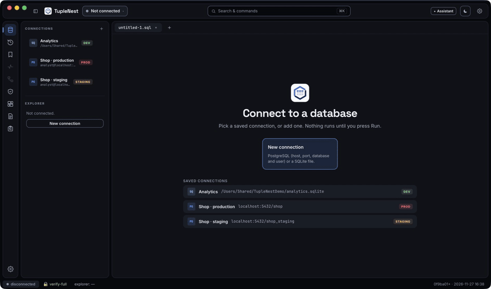
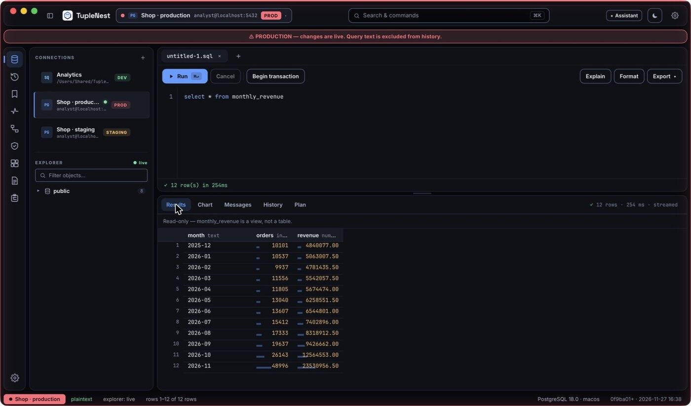
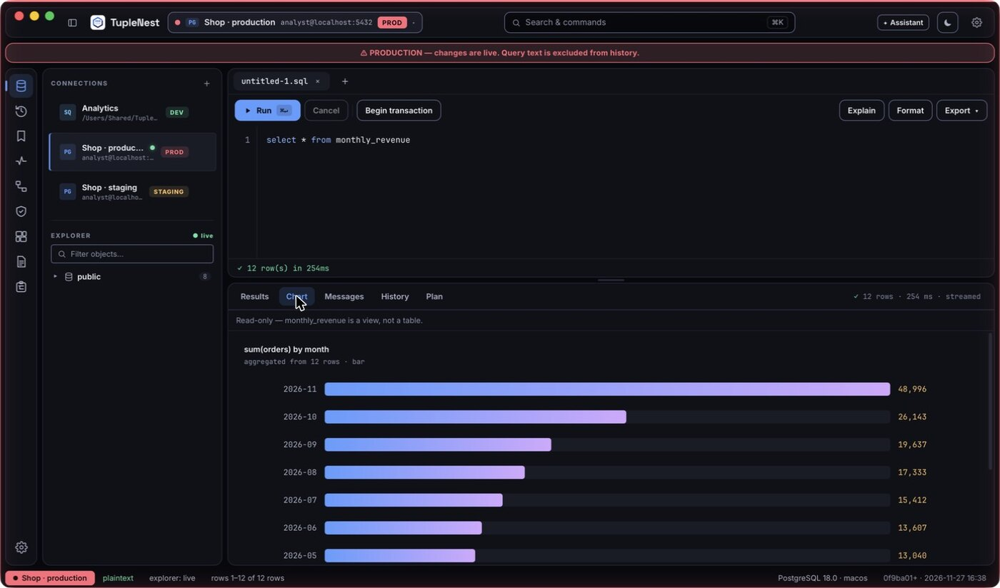
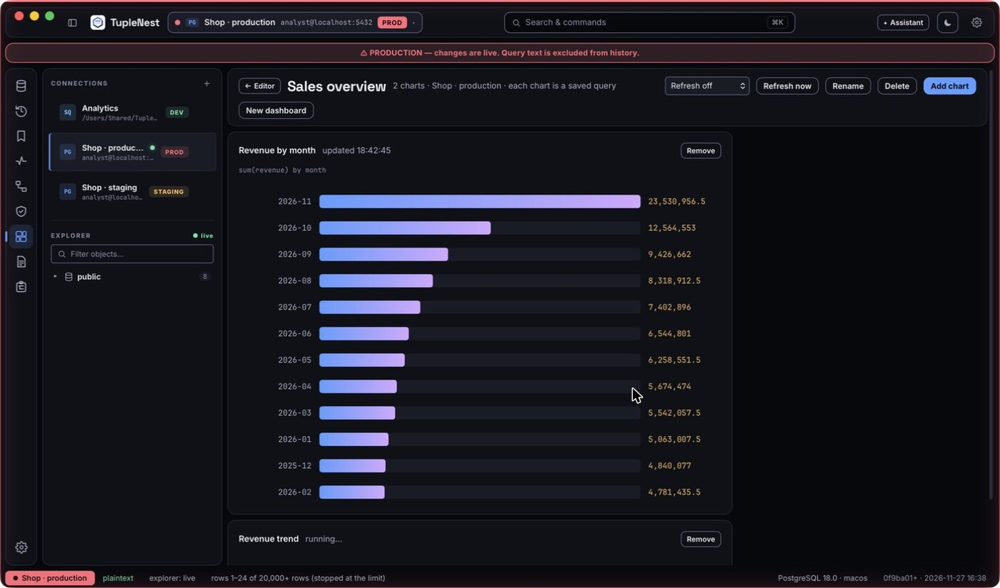
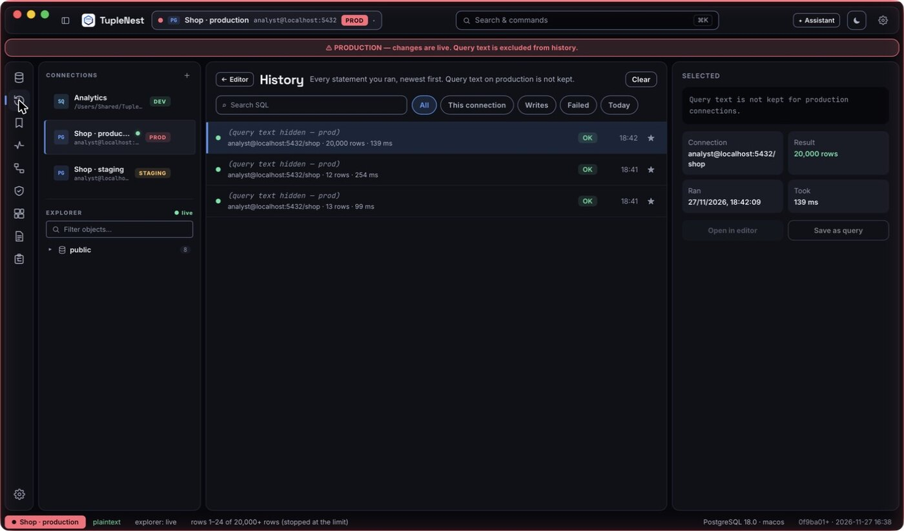
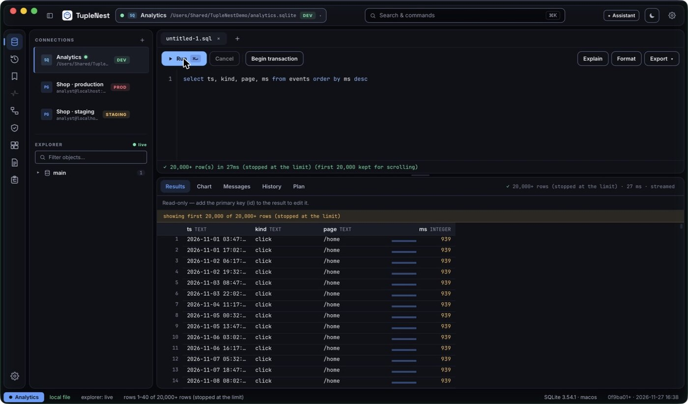
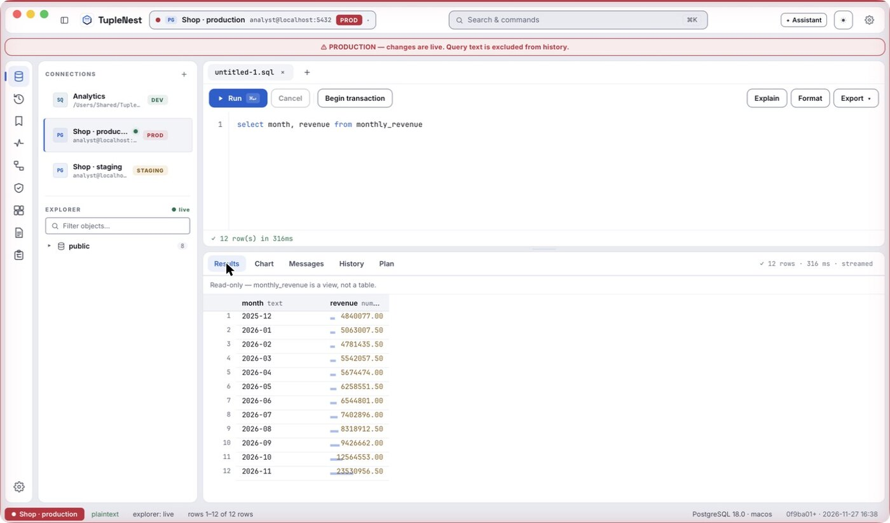
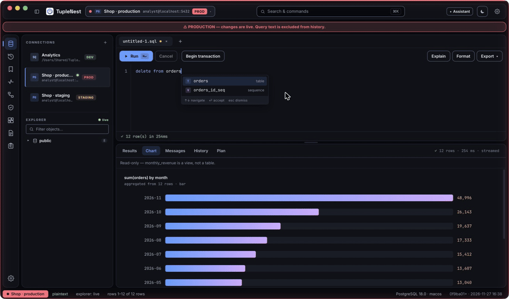
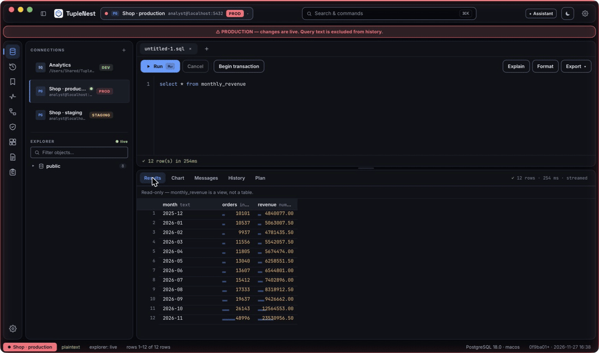
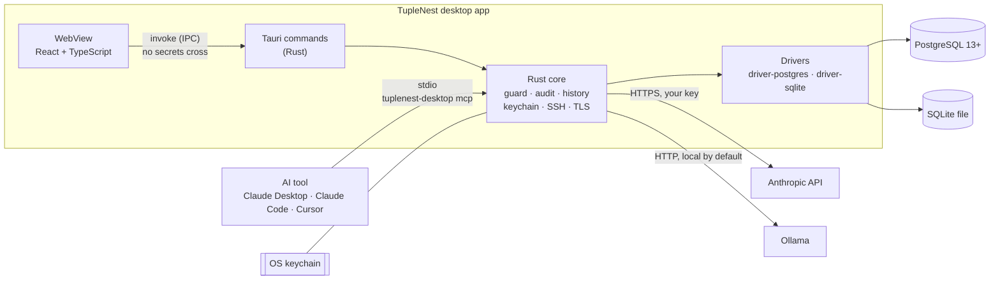

<div align="center">

<picture>
  <source media="(prefers-color-scheme: dark)" srcset="docs/brand/tuplenest-logo-dark.png" />
  
</picture>

**A careful desktop IDE for PostgreSQL and SQLite — it asks before it writes.**

[](https://github.com/talaatmagdyx/TupleNest/releases)
[](https://github.com/talaatmagdyx/TupleNest/actions/workflows/ci.yml)
[](LICENSE)
[](#install)

[Website](https://talaatmagdyx.github.io/TupleNest/) ·
[Download](https://github.com/talaatmagdyx/TupleNest/releases) ·
[Features](#features) ·
[Safety](#the-safety-model) ·
[Assistant](#the-assistant) ·
[MCP](#mcp-server) ·
[Install](#install) ·
[Build](#build-from-source) ·
[FAQ](#faq)

<br/>



</div>

<br/>

TupleNest is an open-source desktop app (Tauri 2, Rust, React) for writing
queries, exploring schemas and looking after PostgreSQL servers and SQLite
files. It runs on your machine: no account, no cloud service, nothing of ours
between you and your database.

> **Beta software.** Releases are pre-releases and nothing is code-signed yet,
> so your OS will warn once on first launch — see [Install](#install).

## Why TupleNest

- **Production is treated as production.** Tag a connection `prod` or
  `staging` and risky statements stop and ask; the worst ones on prod make you
  type the table name. Read-only profiles are enforced by the database, not by
  a disabled button.
- **Your data stays on your machine.** Passwords live in the OS keychain.
  Query text on prod connections is never written to history. There is no
  telemetry. The [network table](#what-leaves-your-machine) lists every
  destination.
- **Two engines, done properly.** PostgreSQL 13+ and SQLite 3, with the same
  safety model on both. No other engines are planned.
- **AI on your terms.** The assistant uses your own Anthropic key or a local
  Ollama model, never sees result rows, and never runs anything by itself. The
  MCP server is off for every connection until you turn it on.

## Features

### Editor, results and charts

<table>
<tr>
<td width="50%" valign="top">

</td>
<td width="50%" valign="top">

</td>
</tr>
</table>

- **Editor** — schema-aware autocomplete (tables after `FROM`, in-scope
  columns, `alias.` columns), format (<kbd>⇧⌘F</kbd>), find and replace,
  comment toggling, `$1…$n` parameters bound as real parameters, multiple tabs.
- **Run and cancel** — <kbd>⌘↵</kbd> runs, Cancel stops it on the server.
  A per-connection statement timeout is enforced by the server.
- **Transactions** — *Begin transaction* opens one owned by that tab;
  committing from another tab is refused, and closing mid-transaction asks.
- **Explain** — the plan view highlights the node that costs the time and,
  for a sequential scan with a filter, offers candidate `CREATE INDEX`
  statements to copy. You can also paste a plan (psql text or JSON) and have
  it analysed without a connection. Nothing is uploaded.
- **Results grid** — streamed, virtualized, keyboard-navigable; numeric
  columns get value bars. A result keeps up to 20,000 rows, and a plain read
  **stops at the limit** instead of reading the rest ("20,000+ rows (stopped
  at the limit)").
- **Row editing with review** — single-table results that include the full
  primary key (or SQLite rowid) can be edited; you review the exact `UPDATE`
  statements before anything is sent.
- **Charts and export** — draw a result as a chart from the results panel's
  Chart tab; export to CSV, JSON or Markdown.

### Pages beyond the editor

<table>
<tr>
<td width="50%" valign="top">

<p align="center"><b>Dashboards</b></p>
<sub>Saved queries that read, pinned as bar, line or single-number charts. They re-run when the page opens and, if you choose, every 1, 5 or 15 minutes. Each run keeps at most 1,000 rows.</sub>
</td>
<td width="50%" valign="top">

<p align="center"><b>History</b></p>
<sub>Search and filter (this connection, writes, failed, today), with the sender of each statement. On prod connections the SQL text is <b>not stored</b> — only timing, row count and status.</sub>
</td>
</tr>
<tr>
<td width="50%" valign="top">

<p align="center"><b>SQLite</b></p>
<sub>A profile is a file path. Read-only is enforced by SQLite itself: the file is opened read-only and <code>PRAGMA query_only</code> is set before every statement.</sub>
</td>
<td width="50%" valign="top">

<p align="center"><b>Light and dark</b></p>
<sub>Both themes are held to WCAG AA contrast by a test. Switch with <kbd>⇧⌘L</kbd>.</sub>
</td>
</tr>
</table>

| Area | What you get |
|---|---|
| **Saved queries and snippets** | Saved queries as cards with tags; reusable snippets in the editor |
| **SQL notebooks** | Text, SQL and chart cells in one document. A SQL cell runs only on its own Run, through the guard and audit log, and keeps its last 200 rows. Export to Markdown |
| **Schema** | Lazy explorer (schemas, tables, columns, indexes, constraints), global object search (<kbd>⌘P</kbd>), ER diagram from real foreign keys, schema diff with generated `ALTER` scripts (destructive lines commented out, never run) |
| **Backup and restore** (PostgreSQL) | Your own `pg_dump` (custom format) and `pg_restore`, run without a shell; the password goes in a private temporary pgpass file. Restoring into prod or staging asks you to type the database name |
| **Users and roles** (PostgreSQL) | Each role's table privileges, with a warning when a role that looks read-only can write. The matching `GRANT`/`REVOKE` is text to copy; nothing is changed |
| **Server monitor** (PostgreSQL) | Backends, cache hit ratio, blocked locks, sessions with cancel and terminate (terminate asks; on prod you type the process id) |
| **Audit log** | On prod connections, the full SQL of each statement, written **before** it runs |
| **Command palette** | <kbd>⌘K</kbd> for every command; <kbd>?</kbd> for the shortcut cheatsheet |

## The safety model

<div align="center">

</div>

<br/>

| Protection | How it is enforced |
|---|---|
| **Read-only profiles (PostgreSQL)** | The session is set read-only on the server (`SET SESSION CHARACTERISTICS … READ ONLY`) and its mode is **re-checked before every statement**. The app also sends only statements that read, because PostgreSQL's read-only mode still allows `VACUUM`, `CHECKPOINT` or `COPY … TO PROGRAM` |
| **Read-only profiles (SQLite)** | The file is opened read-only, `PRAGMA query_only` is set before every statement, and a statement SQLite reports as writing is refused before it runs |
| **Destructive-statement guard** | On connections tagged **prod** or **staging**: `UPDATE`/`DELETE` without a real `WHERE` (including `WHERE 1=1`), `DROP`, `TRUNCATE`, `ALTER`, `CREATE`, `GRANT`, `REVOKE`, `MERGE`, `DO`, `CALL`, `COPY … FROM`, and `EXPLAIN ANALYZE` of any of them, ask first. Comments and strings are masked before matching |
| **Type the name** | On **prod**, an unbounded `UPDATE`/`DELETE`, a `DROP` or a `TRUNCATE` keeps *Run anyway* disabled until you type the target's name |
| **Audit before run** | On prod, each statement is written to the audit log before it is sent; if that write fails, the statement is not sent |
| **History without prod SQL** | Prod query text is never stored in history; elsewhere, common secret literals are scrubbed. `-- tuplenest:no-history` skips a statement entirely |
| **Stop at the limit** | A result keeps at most 20,000 rows; a plain read stops there rather than streaming the rest |
| **TLS** | `verify-full` is the default for new PostgreSQL connections and fails closed |
| **SSH tunnels** | Host keys are verified; key files with a passphrase are supported, the passphrase kept in the keychain |
| **Credentials** | Passwords and passphrases live in the OS keychain (Keychain, Credential Manager, Secret Service). The window never receives them |

The guard is a best-effort check, not a security boundary. For production
data that must not change, connect as a database role without write
privileges. A function with side effects called from a `SELECT` is not
something any client-side check can see. Details: [SECURITY.md](SECURITY.md).

## The assistant

<div align="center">

</div>

<br/>

Open it with **Assistant** in the title bar or <kbd>⌘J</kbd>. Ask about the
query or your tables, **explain** a query, **write SQL** from a plain-English
request, or **fix** a failed statement (shown as a diff). Set up a provider in
**Settings › Assistant**:

- **Claude, with your own Anthropic API key** — the key is stored in the OS
  keychain and deleted when you remove the provider.
- **A local model through [Ollama](https://ollama.com)** — `http://localhost:11434`
  by default. A server on another computer needs *Allow a server on another
  computer*. Ollama **cloud** models run on ollama.com, so they are labelled
  as cloud models that leave this computer, never the default, and refused until you turn on
  *Allow Ollama cloud models*.

**Sent:** your message and the earlier turns of that conversation, the
editor's SQL (for ask, explain and fix), a failed statement's error with the
`DETAIL`/`CONTEXT` lines removed (they can quote row values), and the names
and types of the connected database's schemas, tables and columns, capped in
size.
**Never sent:** result rows, history, the audit log, the connection's host,
user or password, SSH settings, or anything about other connections.

**Nothing runs automatically.** A suggestion goes into the editor only when
you press *Insert into editor* or *Apply the fix*, and runs only when you press
Run — through the same read-only check, guard and audit log as anything you
type. Requests are made by the Rust core; the window never holds your key. The
full list is in [PRIVACY.md](PRIVACY.md#the-assistant).

## What leaves your machine

| Path | Destination | When | What |
|---|---|---|---|
| **Your databases** | The hosts you configure, directly or over your SSH tunnel | When you connect and run | Your queries |
| **Assistant** | `api.anthropic.com` with your key, or your Ollama URL (local by default) | Only when you send a message, press Explain or Fix, or press Test | Your question, the editor's SQL, error text without row values, schema names and types. **No rows** |
| **MCP server** | The AI tool that started it, over stdin/stdout | Only for connections you turned on, when the tool calls | What the tool's queries return, **including rows** — and from there wherever that tool sends them |
| **Update check** | `github.com` | Once at startup | An unauthenticated request for `latest.json`; no identifier |
| **Telemetry** | Nowhere | Never | The setting exists, is off, and no code sends anything |

Everything else — profiles, history, cache, logs, crash reports — stays in
local files. [PRIVACY.md](PRIVACY.md) says where each one lives.

## MCP server

TupleNest is also an [MCP](https://modelcontextprotocol.io) server, so an AI
tool such as **Claude Desktop**, **Claude Code** or **Cursor** can query your
saved connections through TupleNest's safety rules. The app's own binary runs
it as `tuplenest-desktop mcp`: no window, the protocol on stdio. Passwords are
read from the keychain and never returned to the tool.

**Every connection starts Off.** In **Settings › MCP server** choose, per
connection, *Off*, *Read only* or *Read and write*. The same panel shows the
configuration for your install's real path.

| Access | What the AI tool can do |
|---|---|
| **Off** (default) | Nothing. The connection is not listed, and naming it gets the same answer as a name that does not exist |
| **Read only** | A server-enforced read-only session (SQLite's own read-only mode for a file) plus the read-only statement allowlist |
| **Read and write** | Writes run, but anything the guard would ask about is **refused with the reason**, since no one is there to confirm. Not available on prod, staging or read-only connections — those are read-only at most |

One statement per call, at most 500 rows (or 1 MB) per result, marked when cut
off. On prod and staging, statements are written to the audit log before they
run; audit and history record the sender as `MCP · <client name>`.

**Claude Desktop** (`claude_desktop_config.json`) or **Cursor** (`~/.cursor/mcp.json`):

```json
{
  "mcpServers": {
    "tuplenest": {
      "command": "/Applications/TupleNest.app/Contents/MacOS/tuplenest-desktop",
      "args": ["mcp"]
    }
  }
}
```

**Claude Code:**

```sh
claude mcp add tuplenest -- "/Applications/TupleNest.app/Contents/MacOS/tuplenest-desktop" mcp
```

The path above is a macOS placeholder; copy the one Settings shows for your
machine. Tools: `list_connections`, `list_schemas`, `list_tables`,
`describe_table`, `run_query`, `explain` (plain `EXPLAIN`, never `ANALYZE`).

## Install

Download from the [releases page](https://github.com/talaatmagdyx/TupleNest/releases).
Every platform is built from the same source in CI.

| Platform | Files | Notes |
|---|---|---|
| **macOS** 10.15+ | `.dmg` for Apple Silicon or Intel | Drag TupleNest into Applications, then launch it from there |
| **Windows** 10+ | `.exe` (NSIS) or `.msi` | WebView2 is installed if missing |
| **Linux** (glibc 2.35+) | `.AppImage`, `.deb`, `.rpm` | Needs `webkit2gtk-4.1`; saving passwords needs a keyring daemon (GNOME Keyring or KWallet) |

> [!NOTE]
> **Builds are not code-signed yet.** On macOS, Gatekeeper blocks the first
> launch: right-click the app in Applications and choose **Open**, then
> **Open** again. If it says the app "is damaged", that is Gatekeeper's
> message for a quarantined unsigned app:
> `xattr -dr com.apple.quarantine /Applications/TupleNest.app`.
> On Windows, SmartScreen shows "Windows protected your PC": choose
> **More info → Run anyway**.

To check a download came from this repository's release workflow:

```sh
shasum -a 256 -c SHA256SUMS --ignore-missing
gh attestation verify <downloaded-file> --repo talaatmagdyx/TupleNest
```

## Build from source

You need **Rust stable** (install with [rustup](https://rustup.rs); a Homebrew
`rustc` ignores `rust-toolchain.toml`), **Node 22+**, and the
[Tauri prerequisites](https://tauri.app/start/prerequisites/) for your OS.

```sh
git clone https://github.com/talaatmagdyx/TupleNest
cd TupleNest/apps/desktop
npm ci --include=dev      # --include=dev: NODE_ENV=production would drop vite and vitest
npm run tauri dev         # run in development
npm run build:app -- --bundles app   # a local app bundle, no updater signing key needed
```

The bundle lands in `target/release/bundle/`. Tests:

```sh
cargo test --workspace                 # Rust
cd apps/desktop && npm test            # frontend (vitest)
```

Tests that need a live PostgreSQL or sshd are ignored by default;
[CONTRIBUTING.md](CONTRIBUTING.md) shows how to run them.

## Keyboard shortcuts

<kbd>⌘</kbd> is <kbd>Ctrl</kbd> on Windows and Linux. Press <kbd>?</kbd> in the app for the full list.

| Keys | Action | Keys | Action |
|---|---|---|---|
| <kbd>⌘</kbd> <kbd>↵</kbd> | Run query | <kbd>⌘</kbd> <kbd>K</kbd> | Command palette |
| <kbd>⌘</kbd> <kbd>T</kbd> | New query tab | <kbd>⌘</kbd> <kbd>P</kbd> | Search database objects |
| <kbd>⇧</kbd> <kbd>⌘</kbd> <kbd>F</kbd> | Format SQL | <kbd>⌘</kbd> <kbd>O</kbd> | Open connection |
| <kbd>⌘</kbd> <kbd>F</kbd> | Find and replace (editor) | <kbd>⌘</kbd> <kbd>B</kbd> | Show or hide the sidebar |
| <kbd>⌘</kbd> <kbd>/</kbd> | Comment lines (editor) | <kbd>⌘</kbd> <kbd>J</kbd> | Show or hide the assistant |
| <kbd>⌘</kbd> <kbd>C</kbd> | Copy the selected cell | <kbd>⇧</kbd> <kbd>⌘</kbd> <kbd>L</kbd> | Switch light / dark |
| <kbd>Esc</kbd> | Close overlay or page, else cancel the query | <kbd>?</kbd> | Shortcut cheatsheet |

## Architecture



```
apps/desktop/      Tauri 2 app: React/TypeScript frontend (src/), Rust backend (src-tauri/)
crates/            driver-api · driver-postgres · driver-sqlite · connection-core
                   credential-store · ssh-core · workspace-store · metadata-cache
                   result-stream · telemetry
docs/              website (docs/site), brand assets, release runbook
```

- **The window never sees a password.** The credential store hands out opaque
  references; secrets stay in the Rust core and the OS keychain.
- **Writes are parameter-bound**, never built by string concatenation.
- **Safety checks are pure functions** with adversarial test cases.

## FAQ

<details>
<summary><b>Which databases are supported?</b></summary>
<br/>
PostgreSQL 13 and later, and SQLite 3. No other engines are planned.
</details>

<details>
<summary><b>Is it free? Do I need an account?</b></summary>
<br/>
It is MIT-licensed and free. There is no account, sign-in or hosted service.
</details>

<details>
<summary><b>Does the assistant see my data?</b></summary>
<br/>
No result rows are ever sent. It sends your question, the editor's SQL, error
text with row-quoting lines removed, and schema names and types. With a local
Ollama model, nothing leaves your computer. The MCP server is different by
design: an AI tool you connect gets what its queries return, which is why
every connection starts Off.
</details>

<details>
<summary><b>Can it stop me from damaging production?</b></summary>
<br/>
It makes it much harder: read-only profiles enforced by the server, the
statement guard, type-the-name confirmations and an audit log on prod. The
hard boundary is still a database role without write privileges; use one for
production data that must not change.
</details>

<details>
<summary><b>Why does my OS warn when I open it?</b></summary>
<br/>
The builds are not code-signed yet. See <a href="#install">Install</a> for the
click-path, and <code>gh attestation verify</code> to check a file came from
this repository's CI.
</details>

<details>
<summary><b>Where are my settings and history?</b></summary>
<br/>
In a local SQLite file in your OS application-data directory; passwords are in
the OS keychain. <a href="PRIVACY.md">PRIVACY.md</a> lists every file and how
to delete it.
</details>

## Contributing

Bug reports, docs fixes and "this felt wrong" feedback are all welcome. Start
with [CONTRIBUTING.md](CONTRIBUTING.md) and the
[Code of Conduct](CODE_OF_CONDUCT.md).

- [Report a bug](https://github.com/talaatmagdyx/TupleNest/issues/new?template=bug_report.yml)
- [Something felt wrong](https://github.com/talaatmagdyx/TupleNest/issues/new?template=ux_feedback.yml)
- [Discussions](https://github.com/talaatmagdyx/TupleNest/discussions)

## Security

Please report vulnerabilities privately, as described in
[SECURITY.md](SECURITY.md) — not in a public issue.

## Licence

[MIT](LICENSE). One bundled component has its own licence; see
[THIRD-PARTY-NOTICES.md](THIRD-PARTY-NOTICES.md). Changes are listed in
[CHANGELOG.md](CHANGELOG.md).
