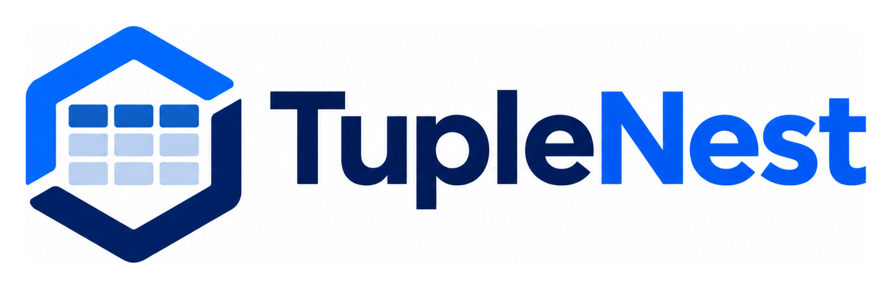
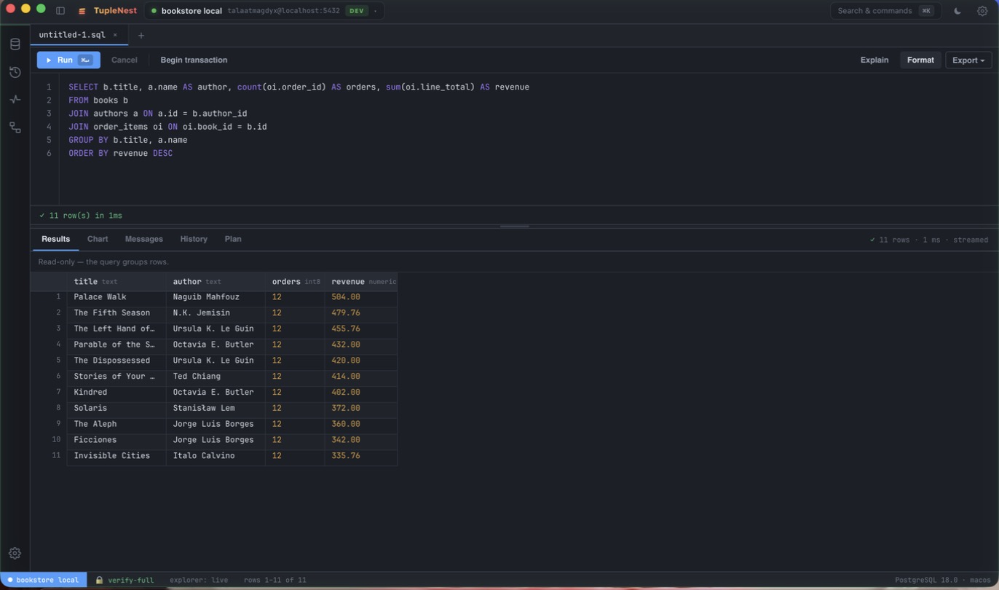
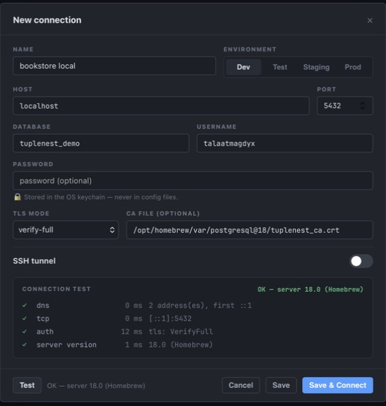
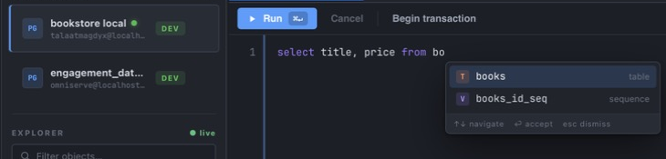
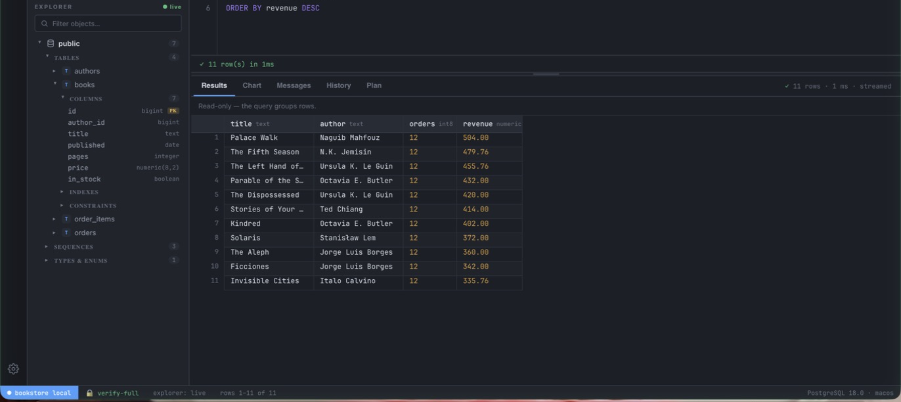
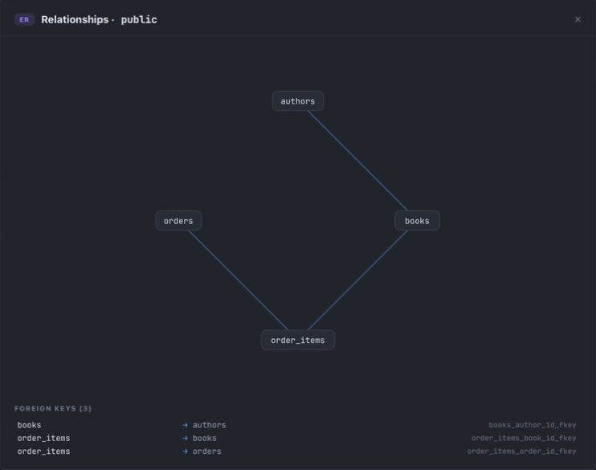
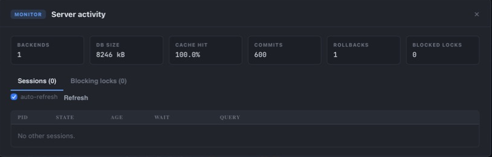
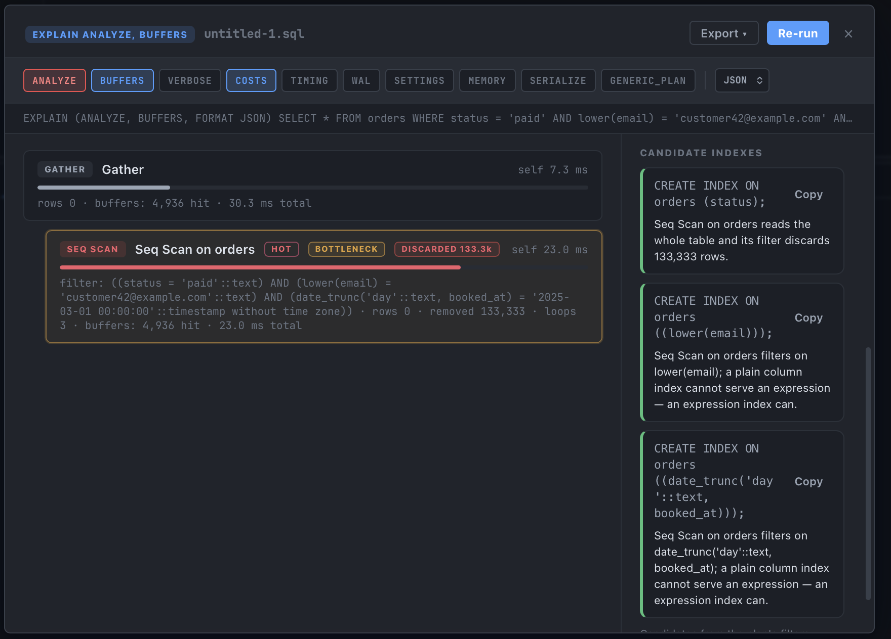

<div align="center">



# TupleNest

### The PostgreSQL and SQLite IDE that **asks before it writes.**

*Fast. Local. Safe by architecture. Simple on purpose.*

<br/>

[](https://github.com/talaatmagdyx/TupleNest/releases/latest)
[](https://github.com/talaatmagdyx/TupleNest/releases)
[](https://github.com/talaatmagdyx/TupleNest/actions/workflows/ci.yml)
[](https://github.com/talaatmagdyx/TupleNest/actions/workflows/codeql.yml)
[](LICENSE)


<br/>

**[⬇️ Download](https://github.com/talaatmagdyx/TupleNest/releases/latest)** ·
[🌐 Website](https://talaatmagdyx.github.io/TupleNest/) ·
[🚀 Quick start](#-sixty-seconds-to-your-first-query) ·
[🛡 Safety model](#-the-safety-model) ·
[⌨️ Keyboard](#%EF%B8%8F-the-keyboard) ·
[🧭 Honest limits](#-what-tuplenest-is-not-yet)

<br/>



</div>

<br/>

> It's 5 p.m. on a Friday. You type `DELETE FROM orders`, forget the `WHERE`,
> and your cursor is hovering over **Run** — on **production**.
>
> Most database tools run it. **TupleNest is built around the other answer.**

Every destructive path in the app **asks first, refuses with a reason, or is
enforced by PostgreSQL itself** — never by a client-side promise. And every one
of those guarantees has a test that executes the misuse and asserts the
refusal, so the claims on this page aren't copy. They're pinned behavior that
CI would catch regressing.

> ⚠️ **Early software, stated plainly.** This is a v0.1.1 beta — tested far
> more than it has been *used*. 2,000+ frontend tests, contract tests against
> live PostgreSQL 13/15/17, SSH tunnel tests against a real sshd. What it
> hasn't had is people living in it. **That's the part you'd be contributing.**

<br/>

## 🪶 Simple on purpose

<table>
<tr>
<td width="25%" align="center"><h3>0</h3><b>accounts</b><br/><sub>No sign-up, no license key, no cloud. Download, open, connect.</sub></td>
<td width="25%" align="center"><h3>60s</h3><b>to first query</b><br/><sub>One dialog between you and <code>SELECT</code>. Passwords go to the OS keychain, not a config file.</sub></td>
<td width="25%" align="center"><h3>1</h3><b>window</b><br/><sub>One window, one session, tabs inside it. No workspace files, no project setup.</sub></td>
<td width="25%" align="center"><h3>2</h3><b>network destinations</b><br/><sub>Your databases + one startup version check to GitHub. A third only if you set up the assistant. That's the <a href="PRIVACY.md">entire network story</a>.</sub></td>
</tr>
</table>

## 🚀 Sixty seconds to your first query

```
1 · Download  →  2 · Press ⌘O, pick PostgreSQL or SQLite  →  3 · Test (staged probe)  →  4 · ⌘↵
```

For PostgreSQL, fill in host, database and user; for SQLite, pick a file. The
**Test** button runs a staged probe — `DNS ✓ TCP ✓ auth ✓ server version ✓` —
so when something is wrong you learn **which layer**, not just *"could not
connect"*. A first launch opens a three-step tour; an update shows what's new
once.

> Nothing is code-signed yet, so your OS will object once on first launch.
> [Install](#-install) has the exact click-path through every dialog you'll see.

<br/>

## 👀 The tour

<table>
<tr>
<td width="50%" valign="top">

<p align="center"><b>Connecting is a diagnosis, not a coin flip</b></p>
<sub>Pick dev / test / staging / <b>prod</b> and the whole window knows it — the frame tints, prod gets a banner, and dangerous verbs ask harder questions. TLS <code>verify-full</code> is the <i>default</i> and fails closed.</sub>
</td>
<td width="50%" valign="top">

<p align="center"><b>Autocomplete that has read your schema</b></p>
<sub>Tables after <code>FROM</code>. In-scope columns in <code>WHERE</code>. <code>alias.</code> → that table's columns. Comments and strings are masked <i>first</i>, so a table name in a comment never poisons suggestions.</sub>
</td>
</tr>
<tr>
<td width="50%" valign="top">

<p align="center"><b>The schema is a place you walk around in</b></p>
<sub>Lazy tree of schemas → tables → columns / indexes / constraints, PK badges inline, backed by a cache that serves instantly — and keeps serving read-only when the connection drops.</sub>
</td>
<td width="50%" valign="top">

<p align="center"><b>The picture and the receipts</b></p>
<sub>The ER view draws the foreign-key graph and names every constraint. Schema diff, find-usages, rename, and EXPLAIN plan comparison live one panel over.</sub>
</td>
</tr>
<tr>
<td width="50%" valign="top">

<p align="center"><b>Operate, not just query</b></p>
<sub>Backends, cache hit ratio, blocked locks, per-session state — with cancel and terminate. Terminating always asks. On prod, it makes you <b>type the pid</b>.</sub>
</td>
<td width="50%" valign="top">
<p align="center"><br/><br/><b>Results stream — they don't "load"</b></p>
<sub>The grid is virtualized and backpressured: bounded batches, a row cap <i>and</i> a byte budget, and a footer that tells the truth about truncation. A checksum test pins that nothing is lost or duplicated in transit.<br/><br/>One decoding rule with teeth: values are decoded from what the type <b>is</b>, never guessed from what the bytes look like. A <code>money</code> value renders as money or as visibly-raw hex — <b>never as a plausible wrong number</b>.</sub>
</td>
</tr>
<tr>
<td width="50%" valign="top">

<p align="center"><b>The plan writes the fix, not just the diagnosis</b></p>
<sub>A sequential scan applying a filter gets you a runnable <code>CREATE INDEX</code> with a copy button — equality columns first, then one range column, the only ordering a btree can seek on. Filters a plain index can't serve get an expression index, preserved character for character because the planner only uses one that matches verbatim.<br/><br/>It reads the column's <i>real type</i> to decide: <code>date_trunc('day', ts)</code> is offered on a <code>timestamp</code> and declined on a <code>timestamptz</code>, which reads the session time zone and so <b>cannot be indexed at all</b>.</sub>
</td>
<td width="50%" valign="top">
<p align="center"><br/><b>…and it shuts up when it isn't sure</b></p>
<sub>Silence on an <code>OR</code> (the planner wants an index per branch), a join condition, an inequality a btree can't seek, or an expression it has no volatility evidence for. <b>A suggestion that errors out costs more than no suggestion</b> — it costs the time to run it and the trust to read the next one.<br/><br/>Every case is round-tripped against a live server: build it, re-run <code>EXPLAIN</code>, confirm the planner actually abandons the seq scan. That round trip caught a statement PostgreSQL refuses outright. 17/17 now, 1.9×–1461× faster where an index is offered.</sub>
</td>
</tr>
</table>

<br/>

## 🛡 The safety model

Five layers — each one names **what actually enforces it**, because *"we're
careful"* is not an architecture:

| Layer | What it does | What enforces it |
|---|---|---|
| 🔒 **Read-only profiles** | Writes are refused | **PostgreSQL itself** (`SET SESSION CHARACTERISTICS … READ ONLY`), with the transaction's mode re-checked on the server before every statement, so the editor can't switch it back. The app also sends only statements that read: PostgreSQL's read-only mode would let `VACUUM`, `ANALYZE`, `REINDEX`, `CHECKPOINT` and `COPY … TO PROGRAM` through. A function with a side effect called from a `SELECT` (`pg_terminate_backend`, …) is not stopped by either. A role without those privileges is the hard boundary |
| ⚠️ **Destructive-statement guard** | On connections tagged prod or staging — **not** dev or test, which is what a new profile starts as — these ask before running: `UPDATE`/`DELETE` with no `WHERE` or an always-true one (`WHERE 1=1`), `DROP`, `TRUNCATE`, `ALTER`, `CREATE`, `GRANT`, `REVOKE`, `MERGE`, `DO`, `CALL`, `COPY … FROM`, and `EXPLAIN ANALYZE` of any of them. `INSERT`, a bounded `UPDATE`/`DELETE`, and a function with side effects called from a `SELECT` do **not** ask | SQL is masked (comments, strings, dollar-quotes) before matching — `-- where` can't disarm it. Best-effort by design: the seatbelt *light*, not the seatbelt |
| ✏️ **Safe row editing** | Only single-table SELECTs with the full primary key are editable; joins, CTEs, groups refused *with a reason* | You review the exact `UPDATE`s first. Parameter-bound, keyed by the full PK, guarded with `IS NOT DISTINCT FROM` — a racing edit affects 0 rows and is **refused**, not silently won |
| 🔁 **Transactions** | The tab that opened a transaction owns it | Committing from another tab is refused and names the owner. Closing mid-transaction always prompts |
| 📦 **Auto-update** | Payloads verified against a minisign key compiled into the binary | The release host only serves bytes — it never holds the key. Updating is refused mid-transaction |

**Every row has a test that executes the misuse and asserts the refusal** —
including thirteen adversarial bypass attempts on the guard, the comma-join
editability hole, and the zero-row concurrent write.

<br/>

## ✦ The assistant

Ask about the query in the editor or the tables in your database, have it
**explain** a slow query, **fix** a failed one from the error view (the fix
comes back as a diff), or **write SQL** from a plain-English request. Open it
with the **Assistant** button in the title bar or <kbd>⌘J</kbd>.

Two providers, chosen per request from the panel's model picker — set them up
in **Settings › Assistant**:

- **Claude, with your own Anthropic API key.** Sonnet 5.5 by default; Opus 5.5
  and Haiku 5.5 on offer. The key is kept in the OS keychain exactly like a
  database password; removing the provider deletes it.
- **A local model through [Ollama](https://ollama.com).** `http://localhost:11434`
  by default. A URL on another computer is refused unless you turn on *Allow a
  server on another computer* — the point of a local model is that nothing
  leaves the machine. Ollama's *cloud* models (`…:cloud`, or listed with a
  `remote_host`) run on ollama.com, so they are marked "cloud via
  ollama.com", never chosen as the default, and refused until you turn on
  *Allow Ollama cloud models*.

**What is sent:** your message (and the earlier turns of that panel
conversation), the editor's SQL when the action uses it, the error's message
and SQLSTATE for a Fix — with the server's `DETAIL`/`CONTEXT` lines, which can
quote row values, removed — and the **names and types** of the connected
database's schemas, tables and columns, capped in size (and, on a SQLite
session, that it is SQLite).
**What is never sent:** row data or result cells, query history, the
connection's host, user or password, or anything about other connections.
The rule is enforced in the Rust core, which makes every request; the window
never touches the network or the key. [PRIVACY.md](PRIVACY.md#the-assistant)
has the full list.

**Nothing it writes runs by itself.** Each SQL suggestion is a card that says
whether it reads or writes, with **Insert into editor** (or **Apply the fix**)
and **Copy**. It runs only when you press Run — through the same read-only
check, production guard and audit log as anything you type.

<br/>

## 🗄 Engines

TupleNest supports two engines, PostgreSQL and SQLite, and no others are
planned. A new connection starts by picking one. Both get the same safety
model: environment tags, read-only profiles, the destructive-statement guard,
the production audit log, and MCP access that is off until you turn it on.

| Engine | Notes |
|---|---|
| **PostgreSQL** 13+ | Everything in this README |
| **SQLite** 3 | A file on this machine: no server, password, TLS or SSH |

**SQLite.** A profile is a file path — type it, or **Choose…** for the
system file panel; **Create a new file** makes an empty database there on
connect (off by default, so a mistyped path is an error rather than a new
empty file). Values come back as stored: `INTEGER`, `REAL`, `TEXT`, `BLOB`
(as hex, like `bytea`) and `NULL`, with declared types as the column types.
Errors carry SQLite's extended result code where a SQLSTATE goes
(`[SQLITE_CONSTRAINT_UNIQUE]`). Declared foreign keys are enforced.

- **Read-only** is enforced by SQLite: the file is opened read-only (an
  `ATTACH`ed file inherits that), `PRAGMA query_only` is set again before
  every statement, and a statement SQLite says would write is refused before
  it runs — so a typed `PRAGMA query_only = OFF` changes nothing and
  `VACUUM INTO 'copy.db'` does not write a copy.
- **The explorer** reads `sqlite_schema` and the table-valued pragmas, every
  name bound as a parameter: `main` and any attached databases, tables,
  views, columns, indexes, keys and foreign keys.
- **Row editing** keys on the `INTEGER PRIMARY KEY`, or the declared primary
  key, with the same review step and "exactly one row" rule. A table with
  neither is edited by its rowid: select it (`SELECT rowid, * FROM t`).
- **EXPLAIN** shows `EXPLAIN QUERY PLAN` as rows in the grid.
- **Not for SQLite**, so hidden or disabled with the reason: the server
  monitor, index and table health and top queries (`pg_stat`), partitions,
  schema and plan comparison, the plan view and `EXPLAIN ANALYZE`, CSV
  import, backup and restore (the database is one file you can copy), users
  and roles, TLS and SSH. Dashboards and notebooks work on both engines.

<br/>

## 🤖 Use TupleNest from AI tools (MCP)

TupleNest is also an [MCP](https://modelcontextprotocol.io) server, so an AI
tool — Claude Desktop, Claude Code, Cursor — can query your **saved
connections through TupleNest**, under the same safety rules. The app binary
runs it when started as `tuplenest-desktop mcp`: no window, protocol on
stdin/stdout, logs in the app's log file. Passwords come from the keychain
entries TupleNest already keeps and are never returned to the tool.

**Nothing is exposed until you choose.** Every connection starts **Off**. In
**Settings → MCP server** pick, per connection, *Off*, *Read only* or *Read
and write*. The same panel shows the configuration to copy, with this
install's real binary path.

**Claude Desktop** (`claude_desktop_config.json`) and **Cursor**
(`~/.cursor/mcp.json`):

```json
{
  "mcpServers": {
    "tuplenest": {
      "command": "/Applications/TupleNest.app/Contents/MacOS/tuplenest-desktop",
      "args": ["mcp"]
    }
  }
}
```

**Claude Code:**

```sh
claude mcp add tuplenest -- /Applications/TupleNest.app/Contents/MacOS/tuplenest-desktop mcp
```

(The path above is macOS's default; Settings shows the one for your machine.)

Tools: `list_connections`, `list_schemas`, `list_tables`, `describe_table`,
`run_query` (one statement, optional `$1…` params, at most 500 rows with a
`truncated` flag) and `explain` (plain `EXPLAIN`, never `ANALYZE`).
SQLite connections work the same way, under the same access levels:
`list_connections` gives their `engine` and file `path`, `list_schemas` is
`main` plus any attached databases, read-only is SQLite's own (see
[Engines](#-engines)), and `explain` is `EXPLAIN QUERY PLAN`.

The rules, all enforced in the backend:

| Access | What an AI tool can do |
|---|---|
| **Off** (default) | Nothing. The connection is not listed, and naming it gets the same answer as a name that does not exist |
| **Read only** | The same server-enforced read-only session a read-only profile gets (`SET SESSION CHARACTERISTICS … READ ONLY`, re-checked before every statement) plus the allowlist of statements that only read |
| **Read and write** | Writes run, but everything the destructive-statement guard would ask about — `UPDATE`/`DELETE` without a real `WHERE`, `DROP`, `TRUNCATE`, `ALTER`, `CREATE`, `GRANT`/`REVOKE`, `DO`, `CALL`, `MERGE`, `COPY … FROM`, `EXPLAIN ANALYZE` of those — is **refused with the reason**: there is no one to confirm it. Not available on connections tagged prod or staging, or marked read-only |

For every access: one statement per call, no `BEGIN`/`COMMIT` (each call is
its own transaction), and statements on **prod and staging are written to the
audit log before they run** — if that write fails, the statement is not sent.
Statements also go to query history; both record the sender as
`MCP · <client name>`. As in the app, a function with side effects called
from a `SELECT` is not something these rules can see: give an AI tool a
database role that can only do what you want it to do.

**What a query returns goes to the AI tool that asked**, and from there to
wherever that tool sends it, its own model provider included. That is what MCP
is for, and why every connection starts Off. This is the one path by which row
data reaches an AI; the assistant above never sends any. The MCP server itself
opens no network connection other than to your databases.

<br/>

## ⌨️ The keyboard

Press <kbd>?</kbd> anywhere for the in-app cheatsheet. <kbd>⌘</kbd> = <kbd>Ctrl</kbd> on Windows/Linux.

| | | | |
|---|---|---|---|
| <kbd>⌘↵</kbd> Run | <kbd>Esc</kbd> Close / back / cancel | <kbd>⌘K</kbd> Command palette | <kbd>⌘P</kbd> Object search |
| <kbd>⌘T</kbd> New tab | <kbd>⌘O</kbd> Connections | <kbd>⌘B</kbd> Sidebar | <kbd>⇧⌘F</kbd> Format SQL |
| <kbd>⇧⌘L</kbd> Dark ↔ light | <kbd>⌘C</kbd> Copy cell | <kbd>⌘J</kbd> Assistant | |

Full keyboard grid navigation with real `role="grid"` semantics · every modal
is a real `role="dialog"` with a focus trap · `prefers-reduced-motion`
respected.

<br/>

## 🧰 Everything else in the box

| | |
|---|---|
| **📝 Query work** | Format SQL · EXPLAIN / ANALYZE plan tab · **candidate `CREATE INDEX` statements from the plan** · find & replace (`⌘F`) and comment toggling (`⌘/`) · a per-connection query timeout the *server* enforces · `$1..$n` parameter binding · **prod audit log** (full SQL of everything run on prod) · CSV/JSON export with an honest truncation note · one-click charts · a result keeps 20,000 rows, and a plain read **stops at the limit** instead of reading the rest ("20,000+ rows (stopped at the limit)") |
| **🗂 Pages** | **History** (search, filters for this connection, writes, failed and today, the sender of each statement) and **Saved queries** (cards with tags) take the editor's place, with one header and a way back (or <kbd>Esc</kbd>) · **Settings** with a section list: General (appearance, results, privacy and updates), Assistant, MCP server, Shortcuts, About |
| **📊 Dashboards & notebooks** | **Dashboards**: saved queries pinned as bar, line or single-number charts, re-run on open and, if you choose, every 1, 5 or 15 minutes. Only a query that reads can be pinned; each run is capped at 1,000 rows · **Notebooks**: text, SQL and chart cells in one document. A SQL cell runs only when you press its Run, through the guard and audit log, and keeps its last 200 rows so the notebook reopens as you left it · Both work on PostgreSQL and SQLite |
| **🗃 Backup & roles** (PostgreSQL) | **Backup and restore** with your own `pg_dump` (custom format) and `pg_restore`, run without a shell; the password goes in a private temporary pgpass file, never on the command line. Restoring into prod or staging asks you to type the database name; a read-only profile is never restored into; SSH-tunnelled profiles are not supported yet · **Users and roles**: each role's SELECT/INSERT/UPDATE/DELETE/TRUNCATE on each table, with a warning when a role that looks read-only can write. It changes nothing: the matching `REVOKE` or `GRANT` is text to copy |
| **🗺 Schema work** | Global object search · column-by-column schema diff · find-usages & rename across tabs (unicode-aware) · **node-by-node EXPLAIN comparison** (which node got slower, and an *ambiguous* label when the pairing is a guess) · **generated `ALTER` migration scripts** — destructive statements come back commented out, and TupleNest never runs them · partition tree browsing |
| **🩺 Health** | Index health report · vacuum & bloat panel · `pg_stat_statements` top queries |
| **📥 Data in** | CSV import wizard — **streams the file, so it is not bounded by RAM** (358 MB / 6M rows imports with ~15 MB peak growth) · RFC-4180 parsing, type inference **you review before anything runs**, batched inserts in one transaction, cancel-and-roll-back mid-import |
| **✨ Fit & finish** | Environment-reactive window frame — dev/staging/prod get different ambient colors, so *the wrong window is visibly the wrong window* · dark, dense, flat — deliberately an IDE, not a dashboard |

<br/>

## 🧭 What TupleNest is *not* (yet)

Marketing pages don't have this section — which is exactly why you should
trust a README that does.

- **Two engines, and only two.** PostgreSQL 13+ and SQLite. There will be no
  MySQL, SQL Server, MongoDB or Redis support. Need one of those? TupleNest
  isn't your tool.
- **The statement guard is best-effort.** It survived thirteen bypass
  attempts, but it's the seatbelt light. Read-only profiles are the seatbelt —
  the *server* enforces those. The airbag is a database role with no write
  privileges: use one for production if a write must be impossible.
- **Nothing is code-signed.** Each OS objects once; the docs walk you through
  it, and the [attestation check](#-verifying-a-download) proves more than the
  dialogs do.
- **No hosted service.** No account, no cloud sync, nothing run by this
  project between you and your database. The [roadmap](https://talaatmagdyx.github.io/TupleNest/roadmap.html)
  says what is next and what is not planned.
- **Saved passwords on Linux need a keyring daemon** (GNOME Keyring /
  KWallet). Connecting works without one; *saving* doesn't.

<br/>

## 📦 Install

**[Download the latest release](https://github.com/talaatmagdyx/TupleNest/releases/latest).**
Every platform builds from the same source in CI: Linux and Windows on their
own runners, both macOS builds on Apple Silicon (Intel is cross-compiled, and
its binary is not run in CI).

Nothing is code-signed yet, so **every OS objects once** — each dialog and its
exact click-path is below, written from what the first beta testers actually
hit.

<details>
<summary><b>🍎 macOS</b> — <code>.dmg</code> (Apple Silicon or Intel) · macOS 10.15+</summary>
<br/>

1. Open the `.dmg`.
2. **Drag TupleNest.app onto the Applications shortcut inside it** — this step
   *is* the install.
3. Eject the DMG, launch from Applications (not from the DMG).
4. First launch: **right-click → Open → Open**. Double-clicking shows
   "unidentified developer" with no way through; the right-click path is the
   only one that offers **Open**.

Or the whole thing in a terminal:

```sh
cp -R /Volumes/TupleNest/TupleNest.app /Applications/
xattr -dr com.apple.quarantine /Applications/TupleNest.app   # skips step 4
open -a TupleNest
```

**"You can't open TupleNest because it is in the Trash"** — the app isn't in
the Trash; your Dock/Launchpad icon points at an older copy you moved there.
Drag the dead icon off the Dock, install from the DMG, launch from
`/Applications` once.

**"TupleNest is damaged and can't be opened"** — not damage: Gatekeeper's
message for an unsigned app it quarantined. `xattr -dr com.apple.quarantine
/Applications/TupleNest.app`. The [attestation check](#-verifying-a-download)
is a stronger guarantee than the dialog you're dismissing.

</details>

<details>
<summary><b>🐧 Linux</b> — <code>.AppImage</code> (recommended), <code>.deb</code>, <code>.rpm</code> · glibc 2.35+</summary>
<br/>

**The AppImage is the fast path** — no root, no package manager:

```sh
chmod +x TupleNest_0.1.0_amd64.AppImage
./TupleNest_0.1.0_amd64.AppImage
```

The `.deb` / `.rpm` integrate with your menus, at the cost of root:

```sh
sudo apt install ./TupleNest_0.1.0_amd64.deb     # Debian/Ubuntu
sudo dnf install ./TupleNest-0.1.0-1.x86_64.rpm  # Fedora/RHEL
```

Needs `webkit2gtk-4.1`. **Saved passwords need a keyring daemon** (GNOME
Keyring / KWallet) — connecting works without one, saving doesn't.

**"Could not get lock /var/lib/dpkg/lock-frontend … (unattended-upgr)"** —
that's Ubuntu's automatic security updater holding the lock *legitimately*,
usually for 1–5 minutes. **Do not delete the lock file.** Use the AppImage, or
wait, or stop it gracefully:

```sh
sudo systemctl stop unattended-upgrades
sudo apt install ./TupleNest_0.1.0_amd64.deb
sudo systemctl start unattended-upgrades
```

</details>

<details>
<summary><b>🪟 Windows</b> — <code>.exe</code> (NSIS) or <code>.msi</code> · Windows 10+</summary>
<br/>

WebView2 installs automatically if missing.

The installer is unsigned, so SmartScreen shows **"Windows protected your
PC"** / **"Unknown publisher"**: click **More info → Run anyway**.

Why not just buy a certificate? Because it wouldn't do what you'd expect: a
standard certificate puts a real publisher name on the installer but the
warning *stays* until the file builds download reputation — which resets every
release. Only an EV certificate skips the wait.
[Verify the download instead](#-verifying-a-download); it proves more than the
dialog does.

</details>

> **Auto-update** points at this repo's releases. While every release is a
> pre-release (all betas), the endpoint 404s and the check fails silently by
> design — upgrading means downloading the next build by hand.

<br/>

## ✅ Verifying a download

```sh
# catches a corrupted or truncated download
shasum -a 256 -c SHA256SUMS --ignore-missing

# proves this exact file came out of this repo's release workflow, at this commit
gh attestation verify TupleNest_0.1.0_aarch64.dmg --repo talaatmagdyx/TupleNest
```

Be clear about what each proves: `SHA256SUMS` sits *next to* the installer, so
it can't defend against a tampered release host — the **attestation** can,
because it's signed by GitHub's OIDC identity, not by anything in the release.
CycloneDX SBOMs (`*.cdx.json`) are attached for anyone auditing dependencies.

Auto-updates are separately signed with a **minisign key compiled into the
binary** — the release host only ever serves bytes.

<br/>

## 🔬 The receipts

The claims on this page are only as good as what checks them. What runs in CI,
on every push:

- **2,000+ frontend tests** — including a suite that *executes each documented
  misuse* (guard bypasses, editability holes, the racing edit, the cross-tab
  commit) and asserts the refusal.
- **Contract tests against live PostgreSQL 13, 15, 17** — a real server, real
  TLS with a CA the tests mint themselves, real cancellation. Not mocks.
- **SSH tunnel tests against a real sshd**, including fails-closed host-key
  paths.
- **A capability test born from a shipped bug:** beta.1's close button
  silently did nothing — one missing ACL permission, rejection swallowed.
  There's now a test cross-checking every window API call against the
  permissions file. This README tells you that story instead of hiding it,
  **because that's the deal here.**
- CodeQL · `cargo deny` (licenses + advisories) · typos · dependency pinning ·
  coverage gate.

<br/>

## 🏗 Under the hood

```
apps/desktop/   Tauri 2 shell — React/TypeScript frontend, Rust commands
crates/         driver-api · driver-postgres · driver-sqlite · connection-core · credential-store
                ssh-core · workspace-store · metadata-cache · result-stream · telemetry
docs/           plans, releasing runbook, landing page
```

Three rules hold the shape:

1. **The frontend never sees a password.** The credential store is an
   opaque-reference API over the OS keychain; secrets never cross IPC.
2. **Writes are never built by string concatenation.** Parameter binding,
   everywhere, no exceptions.
3. **Safety predicates are pure functions** with adversarial test corpora —
   because a safety check you can't unit-test is a safety *vibe*.

```sh
# build from source
cd apps/desktop
npm ci --include=dev                  # NOT plain npm ci — see note
npm run build:app -- --bundles app    # no updater artifacts, so no signing key needed
```

The app lands in `target/release/bundle/` at the repository root. Plain
`npm run tauri build` is what the release workflow runs: it also signs updater
artifacts, and fails at that step without the release key.

<details>
<summary><b>The <code>NODE_ENV</code> gotcha</b> (read before your first build)</summary>
<br/>

If your shell exports `NODE_ENV=production`, npm silently strips `vite`,
`vitest` and `typescript` from the install. Always install with
`--include=dev`. Do **not** "fix" it by exporting `NODE_ENV=development` —
Vite reads that at build time and bundles React's development build into the
release (≈ +400 kB, slower). Install with `--include=dev`; build with
`NODE_ENV` left at production.

</details>

```sh
# test suites
cargo test --workspace                                          # Rust
cd apps/desktop && npm test                                     # 2,000+ frontend
cargo test -p tuplenest-driver-postgres -- --include-ignored    # needs live PG
```

**Supported PostgreSQL: 13+.** Anything older is refused with a reason rather
than half-working — 13 is the oldest version the contract tests actually run
against.

More: [`SECURITY.md`](SECURITY.md) · [`PRIVACY.md`](PRIVACY.md) ·
[`CONTRIBUTING.md`](CONTRIBUTING.md) · [`CODE_OF_CONDUCT.md`](CODE_OF_CONDUCT.md) ·
[`docs/releasing.md`](docs/releasing.md) · [`CHANGELOG.md`](CHANGELOG.md) ·
[`THIRD-PARTY-NOTICES.md`](THIRD-PARTY-NOTICES.md)

<br/>

## 💬 Feedback is the point

This is a beta because the questions that matter now can't be answered by a
test suite: is the editor comfortable, are the shortcuts findable, does it
break on your machine.

| | |
|---|---|
| 🐞 | **[Something broke](../../issues/new?template=bug_report.yml)** |
| 🤔 | **[Nothing broke — it just felt wrong](../../issues/new?template=ux_feedback.yml)** ← *the one that matters most* |
| 💬 | **[Discussions](../../discussions)** for anything shaped like a conversation |

<br/>

<div align="center">

**[MIT](LICENSE)** © [Talaat Magdy](https://github.com/talaatmagdyx) — one shipped component is not MIT, see [`THIRD-PARTY-NOTICES.md`](THIRD-PARTY-NOTICES.md)

<sub>Built with amazing help from <a href="https://claude.com">Claude</a> · design inspired by VS Code</sub>

<br/><br/>

**If the safety model resonates, ⭐ the repo — it tells us to keep going.**

</div>
