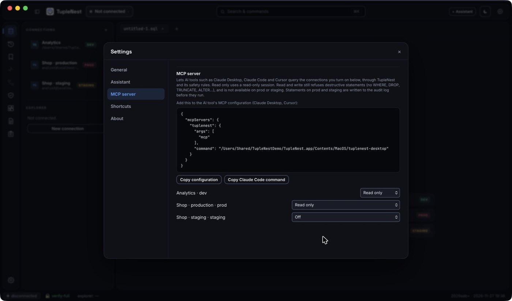

<picture>
  <source media="(prefers-color-scheme: dark)" srcset="docs/brand/tuplenest-logo-dark.svg" />
  
</picture>

### The safety-first database workspace for PostgreSQL and SQLite.

Local-first. Open source. Built for confidence.

**[Download](https://github.com/talaatmagdyx/TupleNest/releases)** ·
[Website](https://talaatmagdyx.github.io/TupleNest/) ·
[Quick start](#quick-start) ·
[Documentation](docs/README.md)

 

 

TupleNest is a desktop app for writing queries, exploring schemas and looking
after PostgreSQL servers and SQLite files. It is built with Tauri 2, Rust and
React, and runs entirely on your computer: there is no account and no hosted
service.

> **Beta.** Every release so far is a pre-release, and the installers are not
> yet signed by Apple or Microsoft, so your OS warns on first launch. The
> [install guide](docs/getting-started/README.md#first-launch) shows the
> extra click and how to verify a download.

## Why TupleNest?

- **Safety.** Connections tagged `prod` or `staging` stop and ask before risky
  statements, and the worst ones on prod make you type the table name.
  Read-only profiles are enforced by the database session, not by a disabled
  button.
- **Privacy.** Passwords stay in the OS keychain. There is no telemetry. Every
  network destination is listed [below](#privacy), with what it receives.
- **Performance.** A native Rust core streams results into a virtualized grid
  and stops reading at a 20,000-row limit. Measurements and how to reproduce
  them are in [docs/benchmarks](docs/benchmarks/README.md).
- **Simplicity.** Two engines, PostgreSQL 13+ and SQLite 3, with one safety
  model for both. No other engines are planned.

## Features

<table>
<tr>
<td width="50%" valign="top"></td>
<td width="50%" valign="top"></td>
</tr>
<tr>
<td width="50%" valign="top"></td>
<td width="50%" valign="top"></td>
</tr>
</table>

- **Editor:** schema-aware autocomplete, formatting, find and replace, `$1…$n`
  parameters bound as real parameters, and multiple tabs.
- **Results:** streamed and virtualized, keyboard-navigable, with charts and
  export to CSV, JSON or Markdown.
- **Row editing with review:** you see the exact `UPDATE` statements before
  anything is sent.
- **Explain:** the plan view highlights the costly node and suggests indexes to
  copy. It never runs them.
- **Schema tools:** a schema explorer, object search, an ER diagram built from
  real foreign keys, and a schema diff whose `ALTER` script is never run.
- **More pages:** dashboards, SQL notebooks, history, saved queries, a server
  monitor, roles and privileges, and backup and restore through your own
  `pg_dump`/`pg_restore`.

The full tour, with screenshots and keyboard shortcuts, is in the
[user guide](docs/user-guide/README.md).

## Safety model

 

TupleNest has two kinds of protection, and they are not equally strong.

**Enforced by the database.** On a read-only PostgreSQL profile the session
is set read-only on the server and re-checked before every statement. A
read-only SQLite file is opened read-only with `PRAGMA query_only` set. A
statement can't get past these by being cleverly written.

**Checks in the app.** On `prod` and `staging` connections the app stops
before:

- `UPDATE` or `DELETE` without a real `WHERE`
- `DROP`, `TRUNCATE`, `ALTER` or `GRANT`
- other risky statements

Other checks in the app:

- **Type the name on prod.** For the worst cases you must type the target's
  name.
- **Audit log on prod.** Each statement is written to the audit log before it
  runs, and it isn't sent if that write fails.
- **One owner per transaction.** A transaction belongs to the tab that opened
  it, and another tab can't commit it.
- **Edits are reviewed.** You see row edits as SQL before they are applied.

These checks are careful but best-effort. A function with side effects called
from a `SELECT`, for example, can't be seen by any client.

**The real boundary is the database role.** For production data that must not
change, connect as a role without write privileges.

Connections are protected too:

- TLS `verify-full` is the default for new PostgreSQL connections and fails
  closed.
- SSH host keys are verified.
- Passwords and passphrases are kept in the OS keychain, and the window never
  receives them.

The full table of protections and their limits is in the
[security guide](docs/security/README.md). To report a vulnerability, see
[SECURITY.md](SECURITY.md).

## AI assistant and MCP

 

**The assistant** (<kbd>⌘J</kbd>) explains a query, writes SQL from a plain
request, or fixes a failed statement. It uses either your own Anthropic API
key or an [Ollama](https://ollama.com) model.

- It receives your message, the editor's SQL, error text and schema names and
  types. It never receives result rows.
- It never runs anything. A suggestion reaches the editor only when you insert
  it, and runs only when you press Run, through the same checks as anything
  you type.

**The MCP server** lets an AI tool such as Claude Desktop, Claude Code or
Cursor query your saved connections through TupleNest's rules.

- Every connection starts **Off**. You choose *Read only* or *Read and write*
  per connection.
- Prod and staging connections can be *Read only* at most.
- Anything the guard would ask about is refused, because there is no one to
  confirm it.
- Unlike the assistant, an MCP client **does receive result rows**, up to
  500 per call.

Setup for each client: [MCP guide](docs/user-guide/mcp.md).

## Privacy

| Data | Where it goes |
|---|---|
| Connection profiles, settings, dashboards, notebooks | A local SQLite file in your OS app-data folder |
| Passwords, passphrases, API keys | The OS keychain (Keychain, Credential Manager, Secret Service) |
| Query history | Local. On `prod` connections the SQL text is **not** stored, only timing, row count and status. Elsewhere, common secret values are removed |
| Production audit log | Local. It **does** keep prod SQL (with secret values removed), as a record of what was run. `-- tuplenest:no-history` does not skip it |
| Assistant with a cloud provider | `api.anthropic.com`, or an Ollama cloud model if you allow those: your message, SQL, error text and schema names and types. Not rows |
| Assistant with a local model | Your Ollama server. `localhost` by default, so nothing leaves the computer unless you point it at another machine |
| MCP clients | The AI tool that started the server gets what its queries return, rows included, and may send it wherever it sends data |
| Update check | `github.com`, once at each start-up. GitHub sees your IP address and a standard request; no ID is sent |
| Telemetry | None. The setting exists, is off, and no code sends anything |

[PRIVACY.md](PRIVACY.md) has the full policy, including where each file lives
and how to delete it.

## Quick start

1. **Download** the installer for your OS from the
   [releases page](https://github.com/talaatmagdyx/TupleNest/releases).
   There are builds for macOS 10.15+, Windows 10+ and Linux with glibc 2.35+.
2. **Launch** TupleNest. On first launch, follow the
   [one-time OS prompt](docs/getting-started/README.md#first-launch).
3. **Create a connection:** a PostgreSQL server, or a SQLite file path.
4. **Set its environment and access.** Tag it `prod`, `staging` or `dev`, and
   choose read-only if you only need to read.
5. **Explore.** Open a table from the sidebar, or write a query and press
   <kbd>⌘↵</kbd>.

To build it yourself, see [docs/development](docs/development/README.md).

## Documentation

| Guide | What's in it |
|---|---|
| [Getting started](docs/getting-started/README.md) | Install, first launch, verifying downloads, updates |
| [User guide](docs/user-guide/README.md) | Every feature and page, keyboard shortcuts |
| [MCP guide](docs/user-guide/mcp.md) | Connecting Claude Desktop, Claude Code or Cursor |
| [Security](docs/security/README.md) | The safety model in full, its limits, audits |
| [Architecture](docs/architecture/README.md) | How the app is put together |
| [Benchmarks](docs/benchmarks/README.md) | What was measured, on what, and how to rerun it |
| [Development](docs/development/README.md) | Building, testing and releasing |
| [Brand](docs/brand/README.md) | Logo, colours and usage |
| [Roadmap](https://talaatmagdyx.github.io/TupleNest/roadmap.html) | What's shipped, what's planned, what's out of scope |

## Contributing and security

Bug reports, doc fixes and "this felt wrong" notes are all welcome. Start with
[CONTRIBUTING.md](CONTRIBUTING.md) and the
[Code of Conduct](CODE_OF_CONDUCT.md), or open a
[bug report](https://github.com/talaatmagdyx/TupleNest/issues/new?template=bug_report.yml)
or a [discussion](https://github.com/talaatmagdyx/TupleNest/discussions).

Please report vulnerabilities privately, as described in
[SECURITY.md](SECURITY.md), not in a public issue.

## License

[MIT](LICENSE). One bundled component has its own licence; see
[THIRD-PARTY-NOTICES.md](THIRD-PARTY-NOTICES.md). Changes are listed in
[CHANGELOG.md](CHANGELOG.md).
