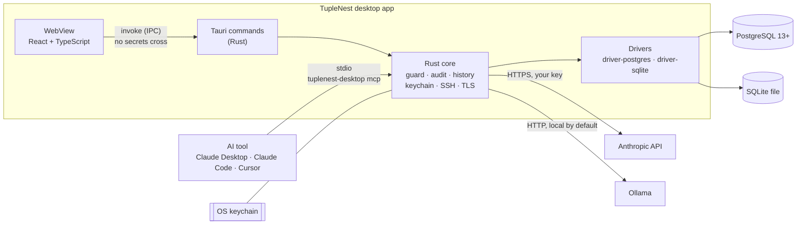

# Architecture



## Layout

```
apps/desktop/      Tauri 2 app: React/TypeScript frontend (src/), Rust backend (src-tauri/)
crates/            driver-api · driver-postgres · driver-sqlite · connection-core
                   credential-store · ssh-core · workspace-store · metadata-cache
                   result-stream · telemetry
docs/              guides, the website (docs/site), brand assets
scripts/           release and signing helpers
```

## Principles

- **The window never sees a password.** The credential store hands out
  opaque references. Secrets stay in the Rust core and the OS keychain.
- **Network calls are made in Rust.** This covers the database, SSH, the
  assistant's provider and the update check. The WebView can't make an
  outside request on its own.
- **Writes are parameter-bound**, never built by joining strings.
- **Safety checks are pure functions** with adversarial test cases. The
  statement guard masks comments and strings before it matches anything.
- **One local store.** Profiles, history, the audit log, dashboards and
  notebooks live in a single SQLite file with numbered schema migrations
  (`crates/workspace-store`).
- **The MCP server is the same binary.** `tuplenest-desktop mcp` starts
  without a window and uses the same core, guard and audit log as the app.
