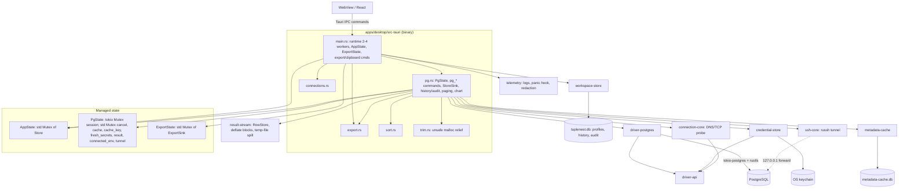

## TupleNest audit — Rust architecture, async, memory and backend measurement

The backend is in good shape: all five cargo checks pass, memory stays bounded on every result shape I ran, and nothing leaked over 100 queries or 100 connect cycles. I found no P0 or P1. Three findings are confirmed by tests I ran (two P2 — the SSH connect hang and freed result memory not returning to the OS — and one P3); the rest are code-evidence only.

One thing to know first: the repo HEAD moved from 5335453 to 63b9505 during the audit (not by me; `git status` is clean). The line numbers in findings 1 and 3–6 were re-grepped at 63b9505; other references are as read at 5335453.

### (a) Commands and environment

Environment: macOS 26.6.2, arm64, 12 cores, 24 GB, rustc/cargo 1.96.1, PostgreSQL 18.0 on localhost. Load average ranged from 181 down to 15 during the session, so wall-clock times are unreliable; memory figures were stable across runs.

| Command | Outcome |
|---|---|
| `cargo fmt --all -- --check` | exit 0, no diff |
| `cargo clippy --workspace --all-targets --all-features -- -D warnings` | exit 0, no warnings |
| `cargo test --workspace` | exit 0. Passed: desktop 54 (2 ignored), driver-postgres 48, workspace-store 22, result-stream 19, telemetry 14, driver-api 5+6, metadata-cache 5, connection-core 3, credential-store 2+3. Ignored: 49 live PG tests and 3 live SSH tests. ssh-core has 0 unit tests. |
| `cargo audit` | exit 0, "6 allowed warnings" (unmaintained crates: chrono RUSTSEC-2026-0543, the gtk3 family via wry). No vulnerabilities reported. |
| `cargo deny check` | exit 0: advisories, bans, licenses, sources all ok. One warning: `deny.toml:39` ignores RUSTSEC-2023-0071, which no longer matches any crate (stale entry). |
| Wide benchmark, 3 runs | Passed; see (c). |

The harness is at `docs/audits/2026-11-24/evidence/audit-rust/harness/src/main.rs` (release build, depends on the repo crates by path, copy of the repo `Cargo.lock`). The `tuplenest_audit_rust` database was created, used, and dropped; I confirmed it is gone and no sessions remain.

### (b) Findings

**1. SSH tunnel open has no timeout; Connect can hang indefinitely**
- **Category / Severity / Confidence:** Async, timeouts / P2 / Confirmed.
- **Location:** `crates/ssh-core/src/lib.rs:132-148` (config sets only `keepalive_interval`; russh's `inactivity_timeout` defaults to `None`); callers `apps/desktop/src-tauri/src/pg.rs:668` (`pg_connect`) and `:595` (`pg_test`).
- **Reproduction:** `audit-harness sshhang` points `open_tunnel` at a local listener that accepts TCP and never speaks.
- **Expected vs actual:** expected an error within a bounded time; actual output was `SSHHANG open_tunnel still pending after 45s against a silent TCP peer (harness gave up)`.
- **Impact:** a bastion that accepts but stalls (a firewall tarpit, the wrong port, a half-dead host) leaves `pg_connect` pending forever. There is no cancel path for a connect. `pg_test` is exposed too, because its 5-second probe only checks that TCP connects.
- **Root cause:** `client::connect` plus authentication are awaited bare, while the PG side has a 15-second `connect_timeout`.
- **Recommendation:** wrap `open_tunnel` (connect + auth) in `tokio::time::timeout` at around 15–20 s, either inside the function or at both call sites.
- **Verify:** the same harness mode returns an error within the bound.

**2. Freed result memory was not returned to the OS in the harness**
- **Category / Severity / Confidence:** Memory / P2 / Confirmed for the harness (the app itself was not measured).
- **Location:** `apps/desktop/src-tauri/src/trim.rs:11-23`, and the claims in its header and in `pg.rs` ("hand those pages … back to the OS").
- **Reproduction:** the harness makes the same `malloc_zone_pressure_relief(NULL, 0)` call after dropping the store.
- **Evidence:**
  - Incompressible text, 16.3 MB compressed in RAM: footprint 20.9–36.9 MB with the result held, 23.3–37.0 MB after drop and trim.
  - 900 KB bytea: 41.2 MB held, 43.0 MB after drop and trim.
  - Mixed 20K rows: 15.4–15.7 MB held, the same after.
- **Expected vs actual:** expected footprint to fall toward the ~2 MB connected baseline; it did not fall in any run.
- **Impact:** the app's idle footprint stays at its high-water mark after a large result. This is bounded (58 MB at most in my runs), so it is an inaccurate claim rather than a leak; 100 sequential queries showed no growth.
- **Root cause:** not established. macOS malloc may be retaining these size classes regardless of the call.
- **Recommendation:** measure in the real app (`footprint <pid>` before and after a large result is replaced) before changing code. If confirmed, correct the comments or drop the call. I am not recommending an allocator swap without that measurement.
- **Verify:** footprint after drop is within a few MB of the pre-query value.

**3. A terminated backend is not recognised as a lost connection until the next statement**
- **Category / Severity / Confidence:** Error contract / P3 / Confirmed.
- **Location:** `crates/driver-postgres/src/lib.rs:2531-2627` (`normalize_error`: db errors fall to `_ => DriverFailure, "Database error"` at `:2565`; only `e.is_closed()` at `:2617` maps to `Network`); consumer `pg.rs` `lost_or_error` and the `broken` check in `pg_query`.
- **Reproduction:** `audit-harness kill` runs `pg_sleep(20)` and calls `pg_terminate_backend` from a second session.
- **Expected vs actual:** expected the first error to be `Network`, so the app's "Connection lost" handling runs and the session slot, cancel handle and tunnel are cleared. Actual:
  - First error: `category=DriverFailure title="Database error" code=57P01`, with `is_broken()` false.
  - Second statement: `category=Network "Connection closed"`, with `is_broken()` true.
- **Impact:** after an admin kill or server shutdown the UI keeps showing a live session (and any open transaction) until the user runs something else. It self-heals on the next statement. Mid-stream I/O errors (`Kind::Io`) are likely misclassified the same way; I did not reproduce that.
- **Recommendation:** map SQLSTATE class 57P0x (admin_shutdown, crash_shutdown, cannot_connect_now, idle_session_timeout) and non-db I/O errors to `Network`.
- **Verify:** the `kill` mode reports `Network` on the first error.

**4. Production audit rows are written after the reply, detached, and failures are discarded**
- **Category / Severity / Confidence:** Reliability / P2 / High-confidence (not reproduced).
- **Location:** `pg.rs:1158-1232`; the detached `spawn_blocking` at `:1210`; `let _ = store.audit_add(...)` at `:1229`.
- **Evidence:** history failures are logged with `tracing::warn!`, but the audit write's error is dropped silently. The audit entry is only created after `execute` returns, and the task is never joined.
- **Expected vs actual:** `workspace-store` sets `synchronous=FULL` so that "a power cut must not drop the last entries". In practice a prod statement that is still running when the app crashes or is killed leaves no audit row, and a failed audit insert (disk full, lock poisoned) leaves no trace anywhere.
- **Recommendation:** at minimum, log audit failures at error level. Consider writing an audit "started" row before `execute` for prod connections.
- **Verify:** a unit test with a store whose `audit_add` fails should assert a log event; kill the process during `pg_sleep` on a prod profile and inspect `audit_list`.

**5. Sync Tauri commands probably run on the main thread, contrary to the code comment**
- **Category / Severity / Confidence:** Async, blocking / P2 / Potential (no GUI validation).
- **Location:** `apps/desktop/src-tauri/src/main.rs:240` and `:326` ("blocking_* must run off the main thread; sync command handlers do"); every non-async command, including `pg_secret_save` (`pg.rs:484`, a keychain call), `pg_metadata_cached`, and the settings/history/snippet/connection commands (SQLite with FULL fsync).
- **Evidence:** `tauri-macros-2.7.6/src/command/wrapper.rs` gives a non-async `fn` `ExecutionContext::Blocking`, which runs inline on the IPC handler thread. I did not find any thread hop in wry's macOS scheme handler. The dialog plugin's own documentation says `blocking_save_file` "should *NOT* be used when running on the main thread" and uses an `async fn` in its example.
- **Impact if true:** SQLite fsyncs and keychain prompts block the UI thread, and `export_begin`/`export_save` rely on the dialog backend's implementation details not to deadlock (highest risk on Linux/GTK).
- **Recommendation:** mark these `#[tauri::command(async)]` or route them through the existing `off_runtime` helper.
- **Verify:** log `std::thread::current().name()` in one sync command, and run an export on each OS.

**6. Blocking SQLite and std-mutex work on the 2–4 async workers**
- **Category / Severity / Confidence:** Async / P3 / High-confidence.
- **Location:** `pg.rs:1712-1750` (`pg_metadata` calls `write_cache` at `:1729` and `read_cache`, both SQLite, while holding the session lock); `authorize_secret` and `with_profile_policy` (called from async `pg_connect`/`pg_test`) take `AppState.store`, the same lock the history writer holds across a FULL-sync commit; `pg_rows` (`:1389`) and `pg_chart` (`:1475`) sort or scan up to 20,000 rows on a worker.
- **Evidence:** benchmark first-sort 43–114 ms, chart 66–100 ms.
- **Impact:** short stalls of one worker; no deadlock.
- **Recommendation:** only if it shows up in practice, move the cache write and first sort to `off_runtime`.

**7. `QueryRequest.row_limit` and `timeout_ms` are accepted and ignored**
- **Category / Severity / Confidence:** Dead API / P3 / High-confidence.
- **Location:** `crates/driver-api/src/request.rs:27-30`; `driver-postgres/src/lib.rs` `execute` never reads either (grep shows no use; the app always passes 0).
- **Impact:** a truncated query still streams the whole result just to count it. Measured: 1M wide rows took 8.4–24.6 s to store 20,000. This is cancellable and memory is flat.
- **Recommendation:** either implement the fields or delete them, as the workspace has already done with other unused scaffolding.

**8. Smaller observations (P3, code evidence only)**
- `pg.rs:1296` decides history status by `msg.to_lowercase().contains("cancel")` instead of `ErrorCategory::Cancelled`, so any error whose text contains "cancel" is recorded as cancelled.
- `PgParams::to_config` hard-codes `Environment::Dev`.
- `RowStore::seal` silently falls back to RAM when the spill write fails (correct and tested below, but there is no log line).
- Module size: `pg.rs` (2,625 lines) mixes params/auth, the sink, history/redaction, paging/chart/export, the metadata cache and transactions; `driver-postgres/lib.rs` (3,207 lines) mixes session, about 500 lines of metadata SQL, and type decoding. This is a maintainability note with no measured defect.

**Checked and found sound**
- **Lock ordering:** no `std::sync::Mutex` guard is held across an `.await`. The order is always the session async mutex, then short-lived std locks. The sink uses `try_lock` on the result slot. I found no deadlock path.
- **Disconnect during a query:** `lock_session` cancels and waits a bounded 3 × (5 s + 5 s).
- **`unsafe`:** the `trim.rs` FFI signatures are correct and take no owned pointers. `Secret::drop` zeroing through `as_bytes_mut` is sound, since NUL bytes are valid UTF-8.
- **Zeroization claims:** `secret.rs` and SECURITY.md are accurate that only the `Secret`'s own buffer is wiped. Not wiped: the IPC request body carrying the password, tokio-postgres `Config` and SCRAM buffers, and keyring intermediates.
- **Panics in production paths:** `expect("sink lock")` (`pg.rs:998`) needs a prior panic to fire; `expect("serde_json writes UTF-8")`, `expect("set just above")` and `expect("deflating … cannot fail")` are effectively unreachable. Startup `expect`s (runtime build, `run`) abort at launch only. None are realistically reachable at runtime.
- **Shutdown:** there is no explicit graceful shutdown. Sessions close when the process exits; the only work at risk is the detached history/audit task (finding 4).

### (c) Measurements

All figures are from release builds, 3 runs each unless noted. Peak figures are `/usr/bin/time -l` on the process. "Held" and "after drop" are in-process `proc_pid_rusage` footprint.

**Wide benchmark** (`pg::wide_bench::wide_result_memory`, 200 columns × 100K rows pushed, 20,000 stored of 100,000 seen, 25.4 MB of text compressed to 1.74 MB, no spill):

| How it was run | Peak footprint | Max RSS |
|---|---|---|
| Test binary directly | 19.2–19.9 MB | 27.8–28.4 MB |
| Via `cargo test` as in the brief | 147.2–147.6 MB | 174.7–175.2 MB |

The `cargo test` figure measures cargo, not the test, so use the direct numbers. Timings: ingest 154–268 ms, unsorted page of 1,000 rows 1.9–6.2 ms, first sort 43–114 ms, chart 66–100 ms.

**Through the real driver against PG 18** (the connected baseline is 2.1 MB footprint):

| Scenario | Rows stored / seen | Peak footprint | Held → after drop + trim | Time (noisy) |
|---|---|---|---|---|
| Narrow, 100K | 20,000 / 100,000 | 3.7–3.9 MB | 3.5 → 3.5 MB | 0.2–0.7 s |
| Narrow, 1M | 20,000 / 1,000,000 | 3.8 MB | 3.5 → 3.6 MB | 1.1–4.4 s |
| Wide 50 columns, 100K | 20,000 / 100,000 | 6.6 MB | 6.2 → 6.3 MB | 2.7–7.4 s (later runs 0.8–2.2 s) |
| Wide 50 columns, 1M | 20,000 / 1,000,000 | 6.4–6.5 MB | 4.6–5.3 → 4.7–5.3 MB | 8.4–24.6 s |
| Mixed, 100K | 20,000 / 100,000 | 14.0–16.5 MB | 10.9–15.7 → same | 1.2–12.3 s |
| Mixed, 20K (all stored, includes the 2 MB bytea rows) | 20,000 / 20,000 | 16.3–16.5 MB | 15.4–15.7 → same | 0.6–0.8 s |
| 1 MB incompressible text × 300 | 134 / 300 | 40.7–46.0 MB | 20.9–36.9 → 23.3–37.0 MB | 7.7–25 s |
| 900 KB random bytea × 200 (1 run) | 74 / 200 | 58.2 MB | 41.2 → 43.0 MB | 7.8 s |

- "Mixed" is 2 KB strings, Unicode, NULL-heavy columns, jsonb, and 2 MB bytea.
- In the mixed 100K run the 2 MB bytea rows fell past the 20,000-row cap and were never decoded; the 20K run covers them.
- The two large-value rows hit the 128 MB byte budget and spilled 56 MB to disk with 16.3–16.7 MB kept in RAM, using one extra file descriptor.
- The store's own counter stops at the cap; the true total comes from the driver's `rows_returned`, and the app takes the larger of the two.
- Batches were capped at 1,000 rows, and at 5 rows for 1 MB values (the 4 MB batch cap), so driver-side backpressure works.

**Repetition:**

| Scenario | Footprint before → after | File descriptors | Other sessions on the audit DB |
|---|---|---|---|
| 100 sequential wide-10K queries | 5.8–5.9 → 5.4–6.4 MB (peak 7.4–7.7 MB) | 16 → 16 | 1 → 1 |
| 100 connect / `select 1` / drop cycles | 2.1–2.2 → 2.6–2.7 MB | 15 → 15 | 0 → 0 (immediately and after 1.5 s) |

Sequential runs took 11–37 s and connect cycles 1.0–2.4 s; both are noisy.

**Other checks:**
- **Spill:** 200K rows with a 64 KB RAM limit spilled 1.59 MB, read back intact, and the file descriptor was released on drop (the temp file is anonymous).
- **Missing temp directory:** with `TMPDIR` pointing at a nonexistent path, the store fell back to RAM (847 KB against the 64 KB limit), with all rows intact and no error.
- **Cancel:** a streaming 50M-row query cancelled in 815 ms and the session was reusable afterwards.

**Caveats:**
- The harness uses a replica of `StoreSink` (same caps and row format), because the real one lives in a binary crate. The real `StoreSink` was exercised only by the wide benchmark.
- TLS was off, and there was no Tauri/IPC layer.
- Every time range above includes scheduler noise from the unrelated VM.

### (d) Architecture diagram

Dependency direction is clean: the leaf crates do not depend on each other except through `driver-api`, and only the desktop binary composes them.

### (e) Strengths worth preserving

- **Two-level bounded results.** The driver cuts batches at 1,000 rows or 4 MB (`driver-postgres/src/lib.rs:128-135`) and stops decoding once the sink is full (`wants_rows`). The store caps on rows and bytes, with first-N prefix semantics (`result-stream/src/lib.rs:188-212`). Measured peak was at most 58 MB on hostile inputs and about 4–7 MB on ordinary million-row results.
- **RowStore spill design.** The temp file is anonymous and unlinked, spill failure falls back to RAM, `file_len` only advances after a successful write, and the LRU is bounded by bytes (`result-stream/src/lib.rs:362-498`).
- **Cancel independent of the session lock.** `pg_cancel` uses a cloned handle; `lock_session` does bounded cancel-and-wait and accounts for the FIFO mutex (`pg.rs:1861`).
- **State published under the session lock.** Cancel handle, tunnel and cache key are set or cleared while the session lock is held, in `pg_connect`, `pg_disconnect` and the error paths, which avoids reconnect races.
- **Blocking work deliberately off the runtime.** Keychain lookups, the history write, export and clipboard go through `spawn_blocking`/`off_runtime`; the runtime is sized at 2–4 workers with 16 blocking threads (`main.rs:525-541`).
- **Defensive wire decoding.** Numeric decoding has explicit bounds (`lib.rs:2008-2045`), cells are capped at 1 MB, and the cap is decided from wire length before decoding.
- **Connection hygiene.** PG `connect_timeout` plus keepalives (`lib.rs:187-189`); no leaked file descriptors or sessions over 100 cycles.
- **Honest secret documentation** (`credential-store/src/secret.rs`), and `panic = "unwind"` with a redacting panic hook.

### (f) Not validated

- Anything needing the GUI: the main-thread claim in finding 5, dialog behaviour, IPC payload copies, WebView memory, and the real app's footprint after a result is replaced (finding 2).
- The real `StoreSink` and `pg_query` path end to end; history/audit timing under a crash (finding 4).
- TLS connections and TLS cancel; SSH tunnels beyond the hang case (authentication, forwarding, teardown, the 3 ignored live tests).
- The 49 ignored live driver tests and the 2 ignored desktop tests were not run.
- Mid-stream network loss (`Kind::Io`) classification; disk-full during spill (only the missing temp directory was tested).
- Windows and Linux behaviour, including `malloc_trim`.
- Mutex-poisoning paths, and a first sort racing a new query, were reviewed by reading only.
- `tls.rs`, `export.rs`, `sort.rs`, `connections.rs`, the `workspace-store` internals and most of the metadata SQL in the driver were only skimmed.
