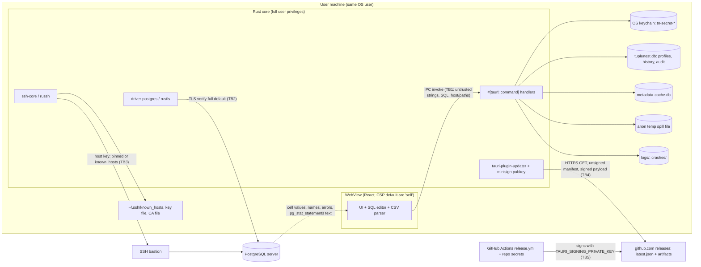

# TupleNest security audit — Tauri boundary, secrets/privacy, supply chain (commit 5335453)

No P0 or P1 findings survived re-checking. The most consequential issues are in the release chain (updater key custody) and in three privacy claims that the code contradicts. Nothing in the repo or on GitHub was modified; scratch output is under `docs/audits/2026-11-24/evidence/audit-sec/`.

## 1. WebView effective permissions

Source: `/Users/talaatmagdyx/work_talaat/TupleNest/apps/desktop/src-tauri/capabilities/default.json:6-16` and `/Users/talaatmagdyx/work_talaat/TupleNest/apps/desktop/src-tauri/src/main.rs:564-576,610-649`.

**Plugin surface (ACL-gated):**
- `core:default` plus `core:window:allow-destroy`.
- `updater:default`: check, download and install, all signature-verified.
- `process:allow-restart`.
- `dialog:allow-ask` only: no open/save dialog from JS.
- `opener:allow-open-url`, limited to exactly `https://github.com/talaatmagdyx` and `https://claude.com`.
- No fs, shell, http or clipboard plugin is registered.

**App commands (not ACL-gated, callable by any script in the main window):**
- Run arbitrary SQL on the live session (`pg_query`), page results, `pg_begin/commit/rollback`, and cancel or terminate any backend pid (`pg_admin_backend`).
- Make the Rust side connect to any host and port (`pg_test`, `pg_connect`), including an SSH hop using any key path and any CA path the page names.
- Read and write settings, layout and snippets; read history and the prod audit log (capped at 1,000 rows per call); clear history.
- Create, modify and delete profiles.
- Write a password into the keychain. No command returns one.
- Write a file only at a path the user picks in a Rust-side native save panel (`main.rs:226-249,300-338`); the page never supplies a path.
- Put up to 10,000 result rows on the clipboard (write only).

**Net effect:** a script-injection in the WebView equals full use of the connected database plus read access to history, audit log and profile metadata. Exfiltration is possible despite the CSP, by connecting to an attacker-run Postgres (`pg_connect`) or by top-level navigation. It does not give arbitrary file read/write, shell, or stored-password retrieval.

The capability test (`main.rs:727-877`) guarantees only that every `getCurrentWindow().x()` call in the frontend has a matching grant. It does not detect over-grants, other plugins, or custom commands.

## 2. Trust-boundary diagram

## 3. Threat model

| Adversary | Attack surface | Existing controls | Residual risk |
|---|---|---|---|
| **Malicious / compromised DB server** | Cell values, identifiers, type names, error text, EXPLAIN text; huge rows; auth-method choice | No `innerHTML`/`dangerouslySetInnerHTML`/`eval` anywhere in `apps/desktop/src` (grep). Identifiers quoted (`lib/dml.ts:71-76`, `lib/intel.ts:170`). Type casts gated by `SAFE_TYPE` (`dml.ts:209`) and fed from `format_type` (`driver-postgres/src/lib.rs:1037`). Values bound as parameters. Row cap 20,000 and 128 MB (`pg.rs:950-962`). Error DETAIL not persisted (`pg.rs:375`). CSV formula neutralisation (`export.rs:186-205`). | In `prefer`/`disabled` modes a server or on-path attacker can request cleartext auth and receive the password; this is warned in the UI for `prefer` only (`ConnectionForm.tsx:234`). `pg_stat_statements` text is cached to disk (F3). |
| **Malicious SSH endpoint** | Host-key spoofing, RSA timing | Fails closed: pinned SHA-256 or existing known_hosts entry; no trust-on-first-use, no accept-any; host certificates rejected (`ssh-core/src/lib.rs:95-122`). | Loopback listener is reachable by other local processes (documented). Encrypted keys and agent are unsupported (F6). |
| **Compromised update server / release host** | `latest.json` (unsigned), artifacts | Minisign verification of payload with compiled-in key `C35ED434C8AECC1B` (plugin `updater.rs:891-907`). Update is user-initiated (`App.tsx:1484-1500`). Version floor (`lib/version.ts`). | Can advertise a high version and serve an old, validly signed build (documented). Can freeze updates or alter release notes. Release assets are mutable (F8). |
| **Malicious repository contribution / dependency** | PRs, Dependabot bumps, build scripts, actions | All actions SHA-pinned. `persist-credentials: false`. Default token read-only. Fork PRs get no secrets. `cargo deny` (crates.io only, licence allowlist). Lockfiles committed. Branch protection with required checks and `enforce_admins`. | 0 required approvals. Signing key and passphrase are repo-level and exposed to the whole build (F1, F2). |
| **Untrusted imported file** | CSV/TSV parsed in WebView | Read via `<input type=file>` (`ImportModal.tsx:266`), no fs access. Column types from a fixed enum, identifiers quoted, values bound (`lib/csv.ts:264-284`). | Memory DoS from a huge file only. No injection path found. |
| **Local attacker, limited privileges (other OS user)** | App-data dir, temp, loopback | Data dir 0700 and SQLite files 0600 — confirmed on this machine by `ls -la`. Passwords only in keychain. Spill file is anonymous/unlinked. | Windows relies on profile ACLs (`secure_dir` is a no-op). SSH tunnel port. Exports are created with the default umask. Same-user attacker is out of scope by policy. |

## 4. Findings

### F1 — Updater signing key and passphrase are repository-level secrets; the `release` environment gate does not protect them
- **Category:** Release chain / secrets. **Severity:** P2. **Confidence:** Confirmed (config fact).
- **Location:** `.github/workflows/release.yml:39-43`; `docs/releasing.md:53-65,225`; `SECURITY.md:90-96`.
- **Evidence:**
  - `gh secret list -R talaatmagdyx/TupleNest` returns `TAURI_SIGNING_PRIVATE_KEY` and `TAURI_SIGNING_PRIVATE_KEY_PASSWORD` (both dated 2026-07).
  - `gh secret list --env release` returns nothing.
  - The `release` environment was created 2026-11-23 with required reviewer = owner, `prevent_self_review: false`, `can_admins_bypass: true`, and branch policy `main` + `v*`.
- **Expected vs actual:** releasing.md step 3 says to move the secrets into the environment "so nothing outside it can read them". Steps 1–2 were done and step 3 was not. The workflow comment says the environment gates "any run … can see it". In fact, any workflow file on any branch that omits `environment:` can read both secrets with no approval.
- **Impact:** anyone holding a write-scoped credential can obtain the key and its passphrase. That key is the single, non-rotatable trust root for every install. `SECURITY.md:96` ("The private key is passphrase-protected and held offline") is false as written: the key and passphrase both sit in GitHub Actions.
- **Honest limit:** the only collaborator is the owner, and a stolen user token could also self-approve an environment deployment. The real delta is modest, hence P2 and not P1.
- **Recommendation:** recreate both as environment secrets on `release`, delete the repo-level copies, and correct the SECURITY.md sentence.
- **Verification:** the repo-level list shows neither secret; `--env release` shows both.

### F2 — The signing key and passphrase are in the environment of the entire build
- **Category:** Supply chain. **Severity:** P2. **Confidence:** High-confidence.
- **Location:** `release.yml:122-127` (preflight runs `npx tauri`), `release.yml:224-231` (tauri-action runs `npm run build` and the full `cargo build` with both secrets and a `contents: write` token in env).
- **Impact:** any build script, proc-macro, or npm package in the 725-crate plus npm tree can read both values during a release. Combined with 0 required approvals and monthly grouped Dependabot PRs, one malicious dependency release yields permanent update-signing capability. The environment approval does not mitigate this.
- **Root cause:** build and sign share one step.
- **Recommendation:** build without the key, then sign the produced bundles in a separate minimal job that runs only `tauri signer sign` and holds the environment secrets. At minimum, add `--ignore-scripts` to `npm ci` in the release job, as the SBOM step already does.
- **Verification:** the build step's `env:` has no `TAURI_SIGNING_*`.

### F3 — `pg_stat_statements` query text and other "live-only" payloads are written to the on-disk metadata cache
- **Category:** Privacy. **Severity:** P2. **Confidence:** High-confidence (unambiguous code; not executed, see §7).
- **Location:** `apps/desktop/src-tauri/src/pg.rs:1729` (unconditional `write_cache`), `pg.rs:1703-1705` (catch-all `_ => cache.put(...)`), `pg.rs:1581,1587-1616` (comments claiming these are never cached); `crates/driver-postgres/src/lib.rs:1540-1561`; `apps/desktop/src/hooks/useHealth.ts:42-52`; `apps/desktop/src/hooks/useSearch.ts:50`.
- **Expected:** `PRIVACY.md:25` says "Cached schema … Table, column and index names … Not row data", and the code comments say live requests are never cached.
- **Actual:** opening the Health panel sends `top_queries`, `index_health` and `table_health` through `pg_metadata`, and each successful response is stored in `metadata-cache.db`. Every search term is stored under its own key.
- **Impact:**
  - `top_queries` holds server-wide statement text from all applications. Utility statements can appear with their literals, depending on server version.
  - This happens on prod-tagged connections too, with no redaction.
  - Entries live until the profile is deleted.
  - On a live error, `pg.rs:1741` serves the stale cached copy as the result, which the comments say must not happen.
- **Root cause:** `cache_scope` assigns a key to every variant and `write_cache` has no allowlist.
- **Recommendation:** cache only `ServerInfo`, `ListSchemas`, `ListObjects`, `DescribeObject`, `ListTypes`, `ListRoutines` and `Relationships`; return early for the rest in both `write_cache` and `read_cache`. Add a migration that deletes the existing rows of those types.
- **Verification:** a unit test asserting that `cache.get(key, "top_queries", …)` is `None` after a `TopQueries` round trip.

### F4 — SQL secret redaction misses common `PASSWORD` forms, and on prod the audit log cannot be opted out of
- **Category:** Secrets at rest. **Severity:** P2. **Confidence:** Confirmed (executed).
- **Location:** `pg.rs:1079-1116` (redactor), `pg.rs:1204,1228-1230` (audit write); `PRIVACY.md:23-24,39-44`.
- **Reproduction:** the two functions were copied verbatim into `docs/audits/2026-11-24/evidence/audit-sec/redact/main.rs` and run.

  | Input | Stored as |
  |---|---|
  | `PASSWORD 'it''s-secret-tail'` | `'[REDACTED]''s-secret-tail'` (tail leaks) |
  | `PASSWORD $$dollar-secret$$` | unchanged |
  | `PASSWORD $pw$tagged-secret$pw$` | unchanged |
  | `PASSWORD E'escape-secret'` | unchanged |
  | `PASSWORD /* c */ 'comment-secret'` | unchanged |
  | `crypt('hunter2', …)`, `pgp_sym_decrypt(card,'aes-key-123')` | unchanged |
  | `PASSWORD 'plain-secret'` | redacted correctly |

- **Impact:** role passwords and encryption keys persist in `tuplenest.db` (0600). The newest 1,000 history rows are kept, favourites are kept forever, and the audit log keeps 5,000. On a prod-tagged connection the statement always lands in `audit_log`: `-- tuplenest:no-history` is deliberately ignored there, so the user has no way to avoid it. The docs do say "best-effort", but they name `PASSWORD '…'` as covered.
- **Recommendation:** after the `password` / `identified by` markers, consume a full SQL string token (doubled quotes, `E''`, `$tag$…$tag$`, intervening comments). For the audit log, store role-password statements as `ALTER ROLE <name> PASSWORD [REDACTED]`.
- **Verification:** add the inputs above to `redact_sql_tests`.

### F5 — "Row data is held in memory only" is contradicted by the result spill file
- **Category:** Documentation / privacy. **Severity:** P3. **Confidence:** High-confidence.
- **Location:** `crates/result-stream/src/lib.rs:54-55,122-128,487-491`; `pg.rs:962`; `PRIVACY.md:31-32`.
- **Detail:** once compressed blocks exceed 16 MB, rows go unencrypted (deflate only) to `tempfile::tempfile()` in the OS temp directory. The file is unlinked on Unix and delete-on-close on Windows, so exposure is low (raw disk or forensic recovery).
- **Recommendation:** state this in PRIVACY.md, or put the file under the 0700 data directory.

### F6 — SSH tunnels support only unencrypted key files
- **Category:** Secrets. **Severity:** P3. **Confidence:** High-confidence. **Type:** Improvement.
- **Location:** `pg.rs:70-73` (`passphrase: None` hard-coded); `crates/ssh-core/src/lib.rs:150-171`.
- **Impact:** there is no ssh-agent path, so users with passphrase-protected keys must create a plaintext private key to use the feature.
- **Recommendation:** add agent auth, or a keychain-stored passphrase via the existing `SecretRef` mechanism.

### F7 — Tested-but-never-saved passwords stay in the keychain indefinitely
- **Category:** Secrets. **Severity:** P3. **Confidence:** High-confidence.
- **Location:** `pg.rs:483-510`; handler list `main.rs:610-649`.
- **Detail:** Test/Connect with a typed password creates a `tn-secret-<uuid>` entry. Entries are deleted only by `connection_delete` or by adopt-replace on save; no command or exit hook removes fresh, unbound ones. `PRIVACY.md:68-70` implies that deleting profiles cleans up.
- **Recommendation:** delete the remaining `fresh_secrets` on window close and on form reset.

### F8 — Release integrity relies on mutable assets and an attestation made over re-downloaded files
- **Category:** Release chain. **Severity:** P3. **Confidence:** Confirmed (config) / High-confidence (attestation scope).
- **Evidence:**
  - `gh api …/immutable-releases` returns `enabled: false`.
  - The tag ruleset "Protect release tags" has `bypass_actors: RepositoryRole 5 (admin), always`.
  - The provenance job attests whatever `gh release download` returns from the draft (`release.yml:294-303,339-341`), not the build job's outputs directly. Assets altered between the two jobs would be attested as genuine.
  - `latest.json` is unsigned and excluded from checksums and attestation (`release.yml:311`). The resulting advertise-high/ship-old downgrade is documented in `lib/version.ts`.
- **Recommendation:** enable immutable releases, and pass artifact digests from the build job to the attest job via job outputs or `upload-artifact`.

### F9 — CSP allows top-level navigation and form submission; no navigation guard
- **Category:** Tauri hardening. **Severity:** P3. **Confidence:** High-confidence. **Type:** Improvement.
- **Location:** `tauri.conf.json:27`; no `on_navigation` anywhere in `src-tauri/src`.
- **Detail:** `default-src` does not cover `form-action` or navigation, so an injected script could exfiltrate via `location=`. This is moot given the `pg_connect` channel, but it is a cheap fix.
- **Recommendation:** add `form-action 'none'` and an `on_navigation` handler that rejects non-app URLs.
- **Related, not a vulnerability:** `tlsCaPath` and SSH `keyPath` are page-supplied strings read by Rust (`tls.rs:159-164`, `ssh-core/src/lib.rs:155-163`). File contents never return, but the error text is a file-existence oracle.

### F10 — Stale accepted-risk entry for RUSTSEC-2023-0071
- **Category:** Dependencies / documentation. **Severity:** P3. **Confidence:** Confirmed (executed).
- **Evidence:** `cargo deny check` prints `warning[advisory-not-detected] … deny.toml:39 "RUSTSEC-2023-0071" no crate matched advisory criteria`. `Cargo.lock` has `rsa 0.10.0`, and `cargo audit` no longer lists it. I did not establish whether 0.10.0 is actually fixed — only that the advisory database no longer matches it.
- **Location:** `deny.toml:23-39`; `SECURITY.md:73-76`.
- **Recommendation:** remove the ignore and the SECURITY.md bullet, or reword it.

### F11 — `e2e/` npm tree has 27 known vulnerabilities and is not covered by Dependabot version updates
- **Category:** Dependencies. **Severity:** P3. **Confidence:** Confirmed (executed).
- **Evidence:** `npm audit` in `e2e/` reports 27 (1 low, 7 moderate, 19 high), mostly `undici`; these match the 17 open Dependabot alerts. `.github/dependabot.yml` lists only `/` and `/apps/desktop`.
- **Impact:** test harness only, not shipped, and it runs in `smoke.yml` with `contents: read` and no secrets.
- **Recommendation:** add `/e2e` to dependabot.yml and run `npm audit fix` there. No blanket upgrade of the app tree is needed: `apps/desktop` `npm audit` and `npm audit --omit=dev` both report 0.

### F12 — Minor documentation and housekeeping items
All P3, Documentation.
- **Licence notices:** `THIRD-PARTY-NOTICES.md:28` says Rust crates and npm packages are "dependencies, not shipped components". They are statically linked or bundled into the distributed binary, so MIT/BSD/Apache notice obligations and MPL-2.0 apply. Ship a generated licence file (e.g. `cargo about`).
- **Entitlements:** `entitlements.plist:18-24` lists app-sandbox entitlements, but the app is not sandboxed and is unsigned, so they grant and restrict nothing.
- **Unused package:** `@tauri-apps/plugin-fs` is still in `package.json` dependencies although unused outside the test mock.
- **Open CodeQL alert:** alert #11 (`rust/hard-coded-cryptographic-value`, critical, `main.rs:610`) is a false positive on `generate_handler!`. Dismiss it with a reason so a real one stands out.
- **TLS through tunnels:** via an SSH tunnel the driver dials `127.0.0.1` (`pg.rs:671`), so verify-full can never match and users must drop to verify-ca. Passing the real host name with `hostaddr` would keep verify-full usable.

## 5. Dependency scan summary

- `cargo audit`: exit 0, 0 vulnerabilities, 6 warnings.
  - Unmaintained: chrono (RUSTSEC-2026-0543, ignored with rationale), proc-macro-error, zbus_names, zvariant, zvariant_derive.
  - Unsound: glib 0.18.5 (RUSTSEC-2024-0429, Linux GTK3 via Tauri).
  - All are transitive through Tauri or keyring except chrono; none has a concrete exploit path here.
- `cargo deny check`: advisories, bans, licenses and sources all ok. Duplicate crates are warnings only; nothing of security consequence was spotted. Both `ring` and `aws-lc-rs` are present.
- Lockfiles committed: `Cargo.lock`, `apps/desktop/package-lock.json`, `e2e/package-lock.json`.

## 6. Privacy and security claims versus code

| Claim | Verdict | Evidence |
|---|---|---|
| "No telemetry / no analytics endpoint" (PRIVACY) | True | No `fetch`/XHR/WebSocket in the frontend; `crates/telemetry` is local logging only; CSP `default-src 'self'`. |
| "Two network destinations: databases + one GitHub update check" | True | Only `check()` at `App.tsx:1466`; opener limited to two URLs on click. The endpoint currently returns 404 (all releases are prereleases), as the README says. |
| "Passwords only in OS keychain; SQLite has only an opaque ref" | True for connection passwords | `connections.rs:113-138`, schema `workspace-store/src/lib.rs:37-46`; no plaintext fallback (`credential-store/Cargo.toml:29-36`). SQL text containing passwords can still be stored (F4). |
| "Secrets never cross IPC back to the WebView" | True | No command returns a secret; `Secret` has no `Serialize`. |
| "A secret ref is honoured only for its own profile, or when typed this session" | True | `pg.rs:208-268`, `connections.rs:70-107`; includes TLS mode, CA and SSH hop. |
| "Row data is held in memory only" | Partly true | Spill file (F5); `top_queries` cache (F3). |
| "Cached schema: names … not row data" | Partly true | Also comments, defaults, enum labels, and health / `pg_stat_statements` payloads (F3). |
| "Prod: history SQL not recorded; audit log keeps full SQL" | True | `pg.rs:1184-1204`. |
| "Secret literals scrubbed (`PASSWORD '…'`)" | Partly true | F4. |
| "Failed-query DETAIL not written to disk" | True | `pg.rs:375-384,1294`. |
| "Logs never contain query text or passwords" | True on reading | Log call sites carry host, db, counts; dependency crates capped at `warn` in release (`telemetry/src/lib.rs:89-101`). |
| "Crash reports local only, redacted" | True | `telemetry/src/lib.rs:230-261`. |
| "verify-ca trusts only the given CA; verify modes fail closed" | True | `tls.rs:78-116,131-192`; `SslMode::Require` at `driver-postgres/src/lib.rs:173-182`. |
| "SSH host keys fail closed; no accept-any" | True | `ssh-core/src/lib.rs:95-122`. |
| "WebView has no filesystem permission; export path chosen in Rust" | True | Capability file; `main.rs:226-338`. |
| "Updater rejects artifacts not signed with our key" | True | Plugin `updater.rs:891-907`; pubkey key id matches the docs. |
| "Private key … held offline" (SECURITY.md:96) | False | Key and passphrase are GitHub repo secrets (F1). |
| "`release` environment stands between the key and any workflow run" (release.yml:39-42) | False as configured | F1. |
| "Attestation proves this file came out of this repo's release workflow" | Partly true | An attestation exists (API lookup for the beta.11 aarch64 dmg returned 1, SLSA v1, `release.yml@refs/tags/v0.1.0-beta.11`), but it attests re-downloaded draft assets (F8). |
| "macOS not notarized, Windows unsigned" | True | Only the two `TAURI_SIGNING_*` secrets exist; no `APPLE_*`. |
| "RUSTSEC-2023-0071 accepted" | Stale | F10. |
| "Read-only enforced by PostgreSQL and re-checked before every statement" | True on reading | `driver-postgres/src/lib.rs:440-466,562-567,614-637`; not live-tested. |

## 7. Strengths worth preserving

- Stored-password binding to the full connection tuple (address, TLS mode, CA and SSH hop) with the "fresh secret" concept (`pg.rs:194-268`).
- Export design where the page never names a path; the streaming sink holds the path Rust-side.
- `SslMode::Require` for both verify modes; verify-ca excludes the OS trust store.
- SSH has no trust-on-first-use and no accept-any; host certificates are rejected, not blindly trusted.
- Persisted error is reduced to title, SQLSTATE and category.
- Data directory 0700 and files 0600, verified on disk.
- `MemoryStore` is behind a `test-support` feature, so it cannot be compiled into the app.
- All actions are SHA-pinned; `persist-credentials: false` everywhere; top-level `contents: read`; secrets passed via env and never interpolated into scripts.
- CSV formula neutralisation; clipboard write is done Rust-side.
- Honest in-code threat notes (`secret.rs`, `version.ts`).

## 8. Not validated

- No runtime test of the built app: IPC from a live WebView, CSP enforcement, and opener scope matching were assessed from config and source only.
- F3 was not executed end to end. I did not query row contents of the real `metadata-cache.db`, per the rules.
- TLS and SSH behaviour against live endpoints, and read-only bypass attempts against a live server, were not run.
- Keychain ACL behaviour per OS was not tested; Windows and Linux file permissions were not observed.
- Whether `rsa 0.10.0` is genuinely unaffected by the Marvin attack.
- Contents of the release artifacts (signature state of the `.app`/`.exe`) were not downloaded or inspected.
- GitHub account-level controls (2FA, PAT scopes) are not visible via the API used.
- `cargo tree -d` was only summarised.
