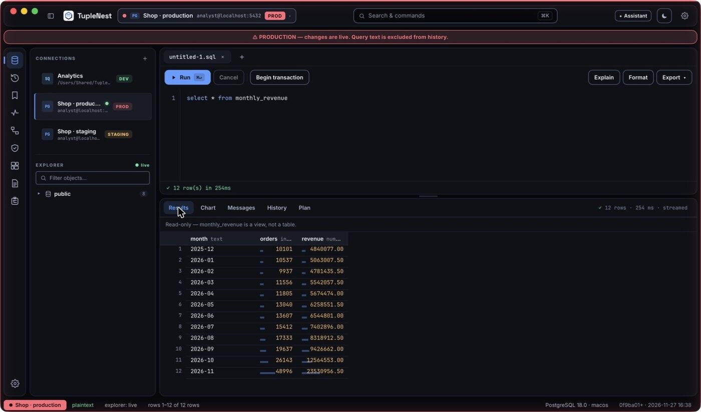
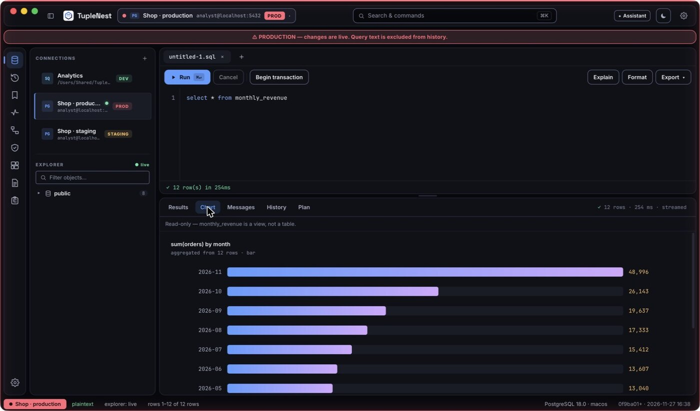
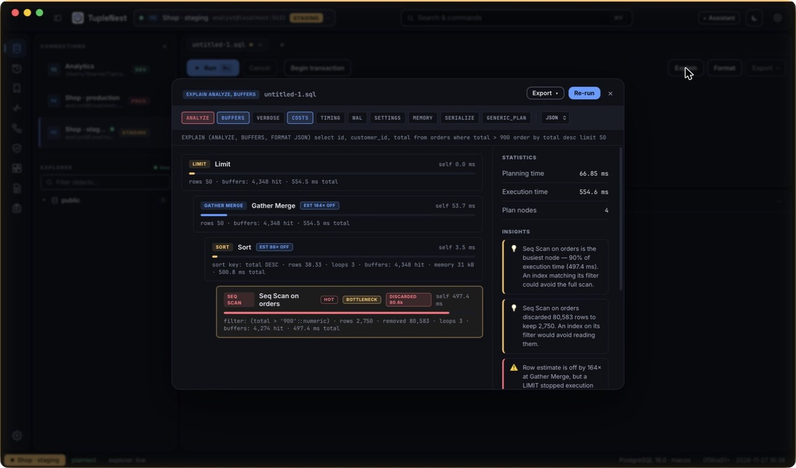
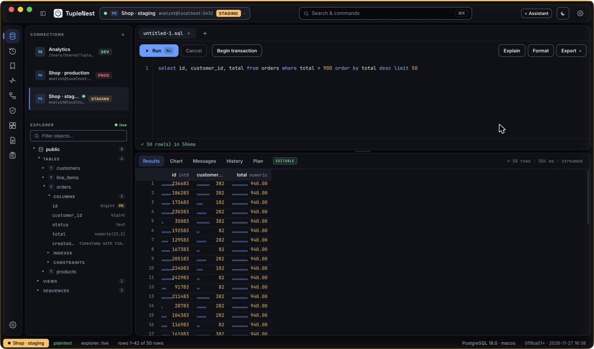
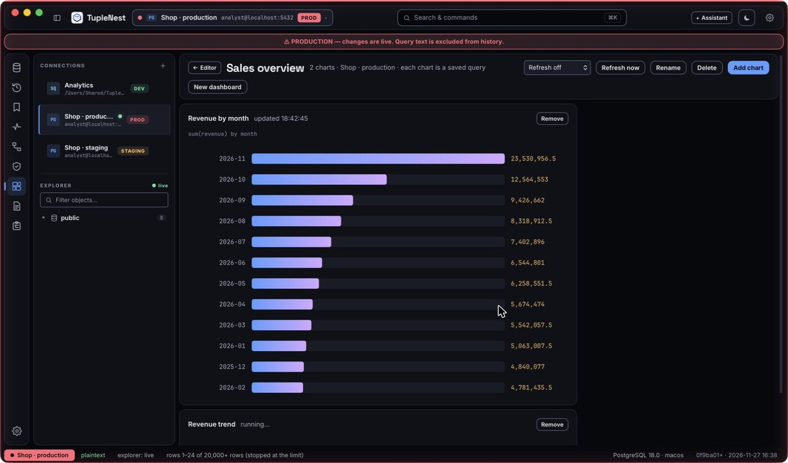
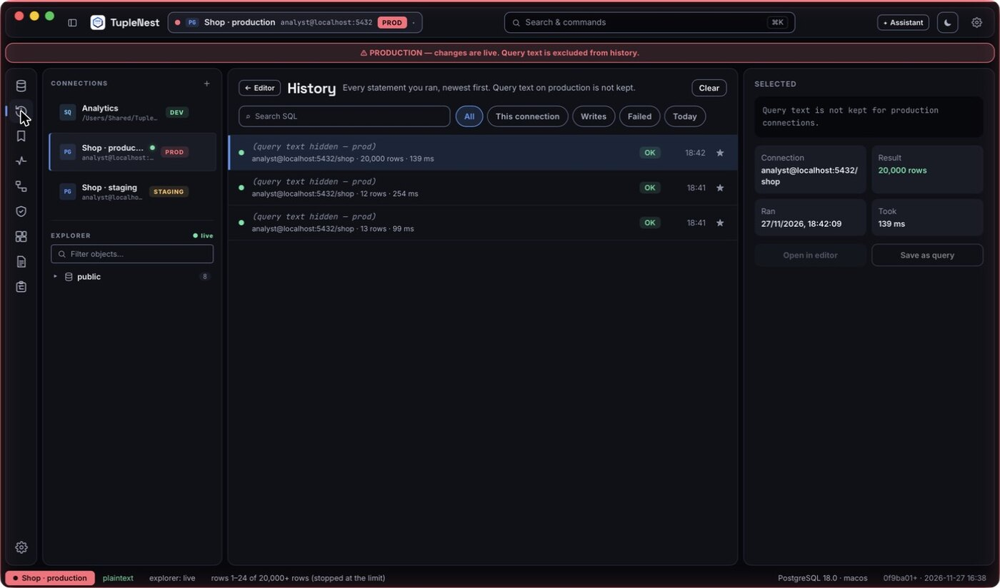
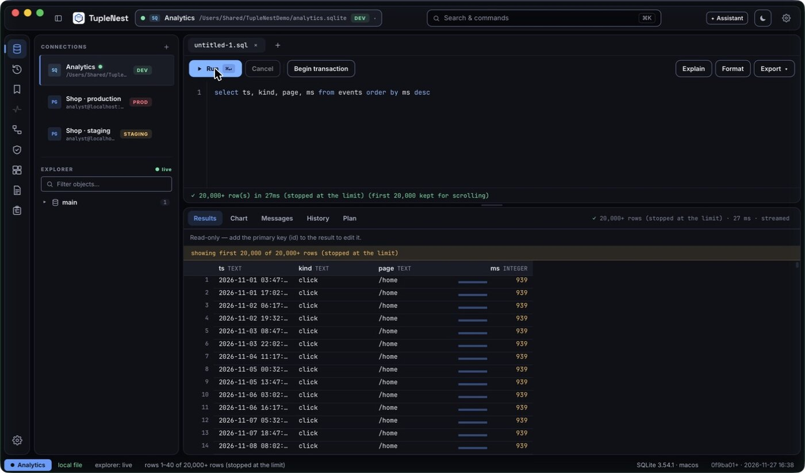
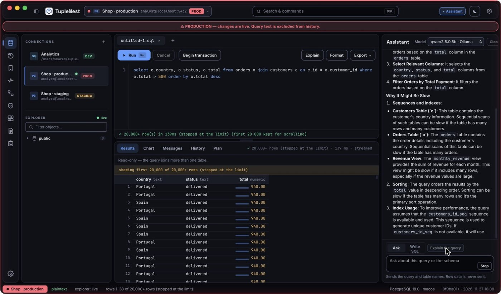
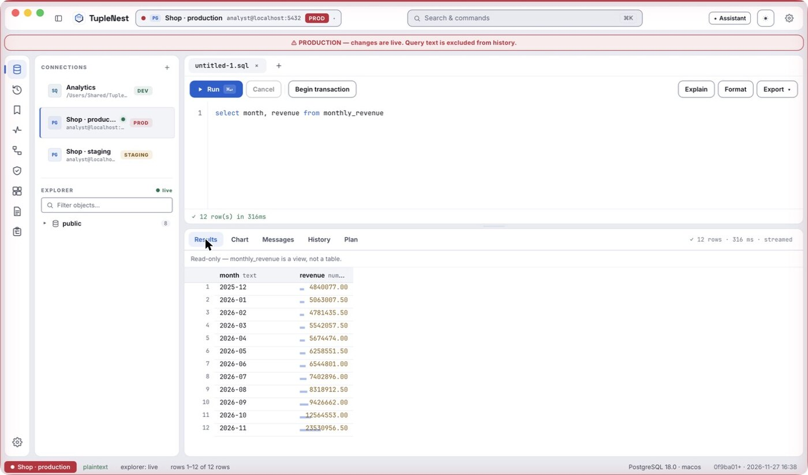

# User guide

Screenshots are from the app, taken on the demo data described in
[docs/site/shots](../site/shots/).

## Editor

- **Autocomplete** knows your schema: tables after `FROM`, in-scope columns,
  and `alias.` columns.
- **Editing:** format (<kbd>⇧⌘F</kbd>), find and replace, comment toggling,
  and multiple tabs.
- **Parameters:** `$1…$n` are bound as real parameters, never pasted into
  the text.
- **Run and cancel:** <kbd>⌘↵</kbd> (<kbd>Ctrl</kbd>+<kbd>Enter</kbd> on Windows and Linux) runs. Cancel stops the statement on the
  server, not just in the window. Each connection can have a statement
  timeout, enforced by the server.
- **Transactions:** *Begin transaction* opens one owned by that tab. Another
  tab can't commit it, and closing a tab mid-transaction asks first.

## Results

- **The grid** is streamed, virtualized and keyboard-navigable. Numeric
  columns get value bars.
- **Row limit:** a result keeps up to 20,000 rows. A plain read stops at that
  limit rather than reading the rest, and says so ("20,000+ rows (stopped at
  the limit)").
- **Row editing:** a single-table result that includes the full primary key
  (or SQLite `rowid`) can be edited. You review the exact `UPDATE` statements
  before anything is sent.
- **Charts and export:** draw a result as a chart from the **Chart** tab, or
  export it to CSV, JSON or Markdown.

## Explain

- **Plan view:** highlights the node that costs the time.
- **Index suggestions:** for a sequential scan with a filter, it offers
  candidate `CREATE INDEX` statements to copy. It never runs them.
- **Pasted plans:** you can paste a plan (psql text or JSON) and have it
  analysed without a connection. Nothing is uploaded.

## Schema

- **Explorer:** schemas, tables, columns, indexes and constraints, loaded as
  you expand them.
- **Object search:** <kbd>⌘P</kbd> searches every object.
- **ER diagram:** built from the real foreign keys.
- **Schema diff:** compares two databases and generates an `ALTER` script.
  Destructive lines are commented out, and the script is never run.

## Pages

| Page | What it does |
|---|---|
| **Dashboards** | Saved queries that only read, pinned as bar, line or single-number charts. They re-run when the page opens and, if you choose, every 1, 5 or 15 minutes. Each run keeps at most 1,000 rows |
| **SQL notebooks** | Text, SQL and chart cells in one document. A SQL cell runs only when you press its Run, through the guard and the audit log, and keeps its last 200 rows. Exports to Markdown |
| **History** | Search and filters (this connection, writes, failed, today), showing who sent each statement: you, or an MCP client. On `prod` the SQL text is not stored |
| **Saved queries and snippets** | Saved queries as tagged cards; reusable snippets in the editor |
| **Backup and restore** (PostgreSQL) | Runs your own `pg_dump` (custom format) and `pg_restore` without a shell. The password goes in a private temporary pgpass file. Restoring into `prod` or `staging` asks you to type the database name |
| **Users and roles** (PostgreSQL) | Each role's table privileges, with a warning when a role that looks read-only can write. The matching `GRANT`/`REVOKE` is text to copy; nothing is changed |
| **Server monitor** (PostgreSQL) | Backends, cache hit ratio, blocked locks, and sessions you can cancel or terminate. Terminate asks first, and on `prod` you type the process ID |
| **Audit log** | On `prod` and `staging`, each statement's SQL (with secret values removed), written before it runs |

## SQLite

A SQLite profile is a file path. Read-only is enforced by SQLite itself: the
file is opened read-only, and `PRAGMA query_only` is set before every
statement. The same guard, audit log and history rules apply as for
PostgreSQL.

## Assistant

<kbd>⌘J</kbd> opens the assistant. You can ask it about the query or your
tables, have it **explain** a query, **write SQL** from a plain request, or
**fix** a failed statement (shown as a diff). Set it up in
**Settings › Assistant**:

- **Anthropic, with your own API key.** The key is stored in the OS keychain
  and deleted when you remove the provider.
- **Ollama.** `http://localhost:11434` by default.
  - A server on another computer needs *Allow a server on another computer*.
  - Ollama *cloud* models run on ollama.com. They are labelled as leaving this
    computer, are never the default, and are refused until you turn on
    *Allow Ollama cloud models*.

What is sent and never sent is listed in
[PRIVACY.md](../../PRIVACY.md#the-assistant). Requests are made by the Rust
core, so the window never holds your key. A suggestion reaches the editor only
when you press *Insert into editor* or *Apply the fix*. It runs only when you
press Run, through the same checks as anything you type.

## Themes

Light and dark themes switch with <kbd>⇧⌘L</kbd>. A test checks the theme
colour pairs against WCAG AA contrast.

## Keyboard shortcuts

<kbd>⌘</kbd> is <kbd>Ctrl</kbd> on Windows and Linux. Press <kbd>?</kbd> in the
app for the full list.

| Keys | Action | Keys | Action |
|---|---|---|---|
| <kbd>⌘</kbd> <kbd>↵</kbd> | Run query | <kbd>⌘</kbd> <kbd>K</kbd> | Command palette |
| <kbd>⌘</kbd> <kbd>T</kbd> | New query tab | <kbd>⌘</kbd> <kbd>P</kbd> | Search database objects |
| <kbd>⇧</kbd> <kbd>⌘</kbd> <kbd>F</kbd> | Format SQL | <kbd>⌘</kbd> <kbd>O</kbd> | Open connection |
| <kbd>⌘</kbd> <kbd>F</kbd> | Find and replace (editor) | <kbd>⌘</kbd> <kbd>B</kbd> | Show or hide the sidebar |
| <kbd>⌘</kbd> <kbd>/</kbd> | Comment lines (editor) | <kbd>⌘</kbd> <kbd>J</kbd> | Show or hide the assistant |
| <kbd>⌘</kbd> <kbd>C</kbd> | Copy the selected cell | <kbd>⇧</kbd> <kbd>⌘</kbd> <kbd>L</kbd> | Switch light / dark |
| <kbd>Esc</kbd> | Close overlay or page, else cancel the query | <kbd>?</kbd> | Shortcut cheatsheet |
