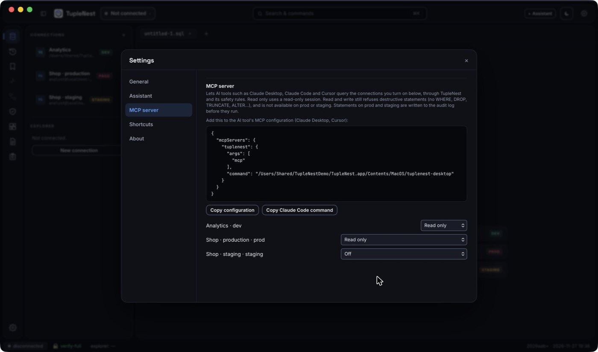

# MCP server

TupleNest is also an [MCP](https://modelcontextprotocol.io) server. An AI
tool such as Claude Desktop, Claude Code or Cursor can then query your saved
connections through TupleNest's rules.

The app's own binary runs the server as `tuplenest-desktop mcp`. It has no
window and speaks the protocol on stdin/stdout. Passwords are read from the
keychain and never returned to the tool.



## Access per connection

Every connection starts **Off**. In **Settings › MCP server**, choose for each
connection:

| Access | What the AI tool can do |
|---|---|
| **Off** (default) | Nothing. The connection isn't listed, and naming it gets the same answer as a name that doesn't exist |
| **Read only** | Queries in a server-enforced read-only session (SQLite's own read-only mode for a file), limited to statements that only read |
| **Read and write** | Writes run, but anything the guard would ask about is **refused with the reason**, because no one is there to confirm. Not available on `prod`, `staging` or read-only connections: those are *Read only* at most |

## Limits and records

- **One statement per call.**
- **Result size:** at most 500 rows or 1 MB per result, marked when it is cut
  off.
- **Audit log:** on `prod` and `staging`, statements are written to the audit
  log before they run.
- **Sender:** audit and history record the sender as `MCP · <client name>`.

**What the tool receives.** An MCP client receives the rows its queries
return. From there they go wherever that tool sends its data, including its
own AI provider. Turn on only the connections you are comfortable sharing that
way, and prefer *Read only*.

## Tools

The server offers these tools:

- `list_connections`
- `list_schemas`
- `list_tables`
- `describe_table`
- `run_query`
- `explain`: plain `EXPLAIN`, never `ANALYZE`

## Client configuration

The settings panel shows the exact command for your install. Copy it from
there; the path below is the macOS default.

**Claude Desktop** (`claude_desktop_config.json`) or **Cursor** (`~/.cursor/mcp.json`):

```json
{
  "mcpServers": {
    "tuplenest": {
      "command": "/Applications/TupleNest.app/Contents/MacOS/tuplenest-desktop",
      "args": ["mcp"]
    }
  }
}
```

**Claude Code:**

```sh
claude mcp add tuplenest -- "/Applications/TupleNest.app/Contents/MacOS/tuplenest-desktop" mcp
```
